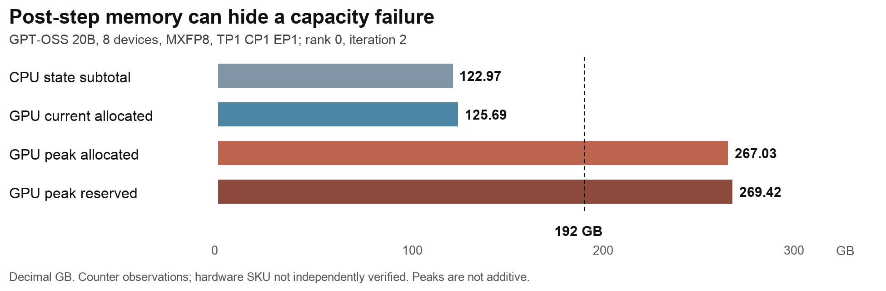

# GPU memory estimates and allocation coverage

The existing estimator is useful for several specific comparisons, but does not yet predict the complete device-memory trajectory for every model. DeepSeek V3's calibrated peak-reserved estimates have retrospective evaluation errors up to 2.85% (671B) and 2.20% (16B). GPT-OSS's frozen component transfer is within 0.59% at rank 0, end of step 2. V4 still requires a measured destination allocation counter; Nemotron approximately 2.3T has no established runtime comparison.

The implementation work is specified in the [allocation coverage plan](plans/2026-10-15-allocation-coverage.md). This report recomputes existing evidence with the current estimator; it does not claim new GPU experiments or completed allocation integration.

## How the comparisons were calculated

**Delta = estimator − GPU measurement. Delta % = 100 × delta / GPU measurement.** Negative values mean an underestimate. Calculations use unrounded inputs; table display is rounded. GB means 10^9 bytes and GiB means 2^30 bytes. V4's printed GB/MB retain an unverified divisor and cannot be converted to device capacity here.

The reproduction checked SHA256 for 29 of 29 original archive logs, re-executed the saved V3 profiles and GPT-OSS state estimator, and recomputed the frozen component and V4 ratio transfers. Profiles were not refitted. The [JSON](validation/allocation_coverage/comparisons.json) records source hashes, configuration, rank, step and method; the [CSV](validation/allocation_coverage/comparisons.csv) contains all 386 comparison/observation rows. Rows are not independent experiments.

Three different questions must remain separate: a calibrated total counter, an implementation-derived state subtotal, and a complete allocation trajectory. Calibration anchors are not validation. All existing transfer/evaluation checks here are retrospective; they are not blind prospective tests.

## Verified configurations

| Model | Framework and hardware | Memory-relevant configuration |
|---|---|---|
| V3 671B | TorchTitan; 256 GB300 | 671,026,404,352 parameters; TP1 PP1 CP1 EP64 FSDP256; sequence 4096; one microbatch/step; FullAC; compiled blocks/loss; AdamW; MXFP8 or mixed NVFP4/MXFP8; local batch 1–16. |
| V3 16B | TorchTitan; 8 GB300 | 15,706,484,224 parameters; 27 layers; hidden 2048; TP1 PP1 CP1 EP8 FSDP8; sequence 4096; FullAC; compiled blocks/loss; AdamW; local batch 1–64. The archive pathname says megatron, but the executing framework is TorchTitan. |
| V4 Pro | Megatron-Bridge/TE; 256 GB300 recipe | 61 layers; hidden 7168; 384 experts, top-6; TP1 PP4 VPP4 EP64 ETP1; sequence 4096; microbatch 1; global batch 4096; selective recompute; attention offload; full-iteration graphs configured. Compared counters precede completed graph capture. |
| V4 hybrid | Megatron-Bridge/TE; 64-device recipe | 15 layers; hidden 7168; 384 experts, top-6; TP1 PP1 CP16 EP64; 64K capacity, single 64K versus packed 4×16K; global batches 256/1024; selective recompute; graph configuration retained. Only 16 ranks have compared counters. |
| GPT-OSS archive | Megatron-Bridge/TE; 8, 72, 512 devices | 20,495,244,864 parameters; 24 layers, hidden 2880; 32 experts, top-4; vocabulary 128256; sequence 8192; PP1 ETP1; meshes shown below. Hardware SKU is not independently established from these logs. |
| GPT-OSS probes | Megatron-Bridge/TE; 4/8 GB200 | Same 128256-vocabulary model; TP1 PP1 CP2 EP4; sequence 8192, microbatch 1, global batch world/2; public NGC 26.09; six steps, paired control/traced runs. |

Historical V3 671B uses TorchTitan a615ec2; 16B uses 791f241. Those GPU observations do not validate a changed implementation at the currently pinned 6078523 revision. Exact metadata and unknown version fields remain in the saved profiles. GPT-OSS shape/partition projections match the logged local parameter counts in all five archived runs.

## DeepSeek V3 671B

Metric: largest logged peak-reserved counter between metric resets, in **GiB**. The historical source audit establishes this counter; the raw parser's generic counter label alone does not. The log does not establish an all-rank maximum.

| Case | Estimator | GPU | Delta | Delta % |
|---|---:|---:|---:|---:|
| mxfp8, batch 1; fit | 57.430 | 57.430 | +0.000 | +0.00% |
| mxfp8, batch 2; evaluation | 63.283 | 61.530 | +1.753 | +2.85% |
| mxfp8, batch 4; fit | 74.990 | 74.990 | +0.000 | +0.00% |
| mxfp8, batch 8; evaluation | 104.840 | 105.060 | -0.220 | -0.21% |
| mxfp8, batch 16; fit | 164.540 | 164.540 | +0.000 | +0.00% |
| nvfp4, batch 1; fit | 57.430 | 57.430 | +0.000 | +0.00% |
| nvfp4, batch 2; evaluation | 62.370 | 61.230 | +1.140 | +1.86% |
| nvfp4, batch 4; fit | 72.250 | 72.250 | +0.000 | +0.00% |
| nvfp4, batch 8; evaluation | 99.417 | 98.690 | +0.727 | +0.74% |
| nvfp4, batch 16; fit | 153.750 | 153.750 | +0.000 | +0.00% |

Fit rows reproduce their calibration anchors by construction. Evaluation rows were excluded from the numerical fit, but were already available during model selection. The model interpolates only local batch in the recorded context. Its effective fixed and batch-dependent allowances include unresolved runtime and allocator effects; they are not identified physical allocations. Do not add separate cache/workspace factors on top of this total.

## DeepSeek V3 16B

Metric: largest logged peak-reserved counter between metric resets, in **GiB**. The historical source audit establishes this counter; the raw parser's generic counter label alone does not. The log does not establish an all-rank maximum.

| Case | Estimator | GPU | Delta | Delta % |
|---|---:|---:|---:|---:|
| mxfp8, batch 1; fit | 33.530 | 33.530 | +0.000 | +0.00% |
| mxfp8, batch 2; evaluation | 35.151 | 34.490 | +0.661 | +1.92% |
| mxfp8, batch 8; fit | 44.880 | 44.880 | +0.000 | +0.00% |
| mxfp8, batch 32; evaluation | 86.700 | 86.520 | +0.180 | +0.21% |
| mxfp8, batch 64; fit | 142.460 | 142.460 | +0.000 | +0.00% |
| nvfp4, batch 1; fit | 33.490 | 33.490 | +0.000 | +0.00% |
| nvfp4, batch 2; evaluation | 34.943 | 34.190 | +0.753 | +2.20% |
| nvfp4, batch 8; fit | 43.660 | 43.660 | +0.000 | +0.00% |
| nvfp4, batch 32; evaluation | 81.859 | 81.600 | +0.259 | +0.32% |
| nvfp4, batch 64; fit | 132.790 | 132.790 | +0.000 | +0.00% |

Fit rows reproduce their calibration anchors by construction. Evaluation rows were excluded from the numerical fit, but were already available during model selection. The model interpolates only local batch in the recorded context. Its effective fixed and batch-dependent allowances include unresolved runtime and allocator effects; they are not identified physical allocations. Do not add separate cache/workspace factors on top of this total.

The 16B profile is a separate fit: transferring the 671B coefficients can miss by about 35%. Close agreement within either batch sweep therefore does not establish model-independent or GPU-generation-independent accuracy. These profiles also cannot reconstruct allocations and frees between log samples.

## GPT-OSS archived runs

The CPU model computes parameter, gradient, master-weight, Adam-state and retained optimizer-gradient storage from the tensor inventory and mesh. FP32 optimizer gradient shards are still live at this reporting point and are included. The following **GB** comparison is a state subtotal versus total current allocated at rank 0 after iteration 2. Its negative delta is the unmodeled remainder, not a full-model prediction error.

| Case | Estimator | GPU | Delta | Delta % |
|---|---:|---:|---:|---:|
| MXFP8, world 8, TP1 CP1 EP1; rank 0, step 2 | 122.971 | 125.690 | -2.719 | -2.16% |
| NVFP4, world 8, TP1 CP1 EP2; rank 0, step 2 | 84.738 | 95.593 | -10.855 | -11.36% |
| MXFP8, world 72, TP1 CP2 EP4; rank 0, step 2 | 29.185 | 31.602 | -2.417 | -7.65% |
| NVFP4, world 72, TP1 CP2 EP4; rank 0, step 2 | 29.185 | 35.382 | -6.197 | -17.52% |
| MXFP8, world 512, TP2 CP4 EP8; rank 0, step 2 | 12.960 | 14.306 | -1.346 | -9.41% |

The remainder varies with quantization, topology and batch. The archived runs alone cannot uniquely divide it into caches, workspaces and communication buffers. A single multiplier transferred from the 8-device case underpredicted larger configurations in earlier checks; the component experiments below provide stronger evidence.

## GPT-OSS GB200 component experiments

Control runs below show rank-0 current allocated after step 2, while peak columns take the maximum over all captured ranks in the six-step observation window. Each peak column may come from a different rank or time. All values are **GB**. No CPU estimate of the full transient peak is available yet.

| Configuration | CPU state | GPU current rank 0 | State delta | Delta % | GPU peak allocated | GPU peak reserved | Max sampled device used |
|---|---:|---:|---:|---:|---:|---:|---:|
| fp8_mx, world 4, control | 106.611 | 109.451 | -2.839 | -2.59% | 139.998 | 165.417 | 172.402 |
| nvfp4, world 4, control | 106.611 | 113.644 | -7.033 | -6.19% | 120.490 | 127.807 | 134.809 |
| fp8_mx, world 8, control | 65.621 | 68.158 | -2.537 | -3.72% | 108.943 | 123.789 | 131.049 |
| nvfp4, world 8, control | 65.621 | 72.229 | -6.608 | -9.15% | 83.288 | 91.312 | 98.583 |

The 8-GPU NVFP4 control peak is 83.288 GB on rank 3, versus 79.091 GB on rank 0. Profiling rank 0 alone misses the worst observed rank. Sampled device usage is a lower bound on the true continuous device-wide maximum; it includes allocations outside PyTorch and is not interchangeable with reserved memory.

The detailed traced rank-0 snapshot at step 2 separates these components. Values are **GB**; ownership is stronger evidence than a stack-based label.

| Component | MXFP8 8 GPUs | NVFP4 8 GPUs | Evidence |
|---|---:|---:|---|
| CPU state | 65.620671 | 65.620671 | Tensor inventory and partition policy |
| Storage padding correction | 0.000003 | 0.000003 | Owned storage |
| Quantized caches | 1.314718 | 5.084283 | Owned backend tensors |
| Dummy gradient candidates | 0.841605 | 0.841605 | Allocation stack hints |
| GEMM workspace candidates | 0.201332 | 0.234886 | Allocation stack hints |
| Other requested storage | 0.042470 | 0.035524 | Unattributed remainder |
| Allocator block slack | 0.137172 | 0.412028 | Allocator snapshot |
| Total current allocated | 68.157970 | 72.229000 | Measured traced snapshot |

The instrumented HybridEP external allocator separately reports 0.113246 GB at this point. It is outside the PyTorch total above; it is not a complete census of all NCCL, driver or external memory. The table reconciles one measured snapshot and does not independently validate its own component labels or lifetimes.

A more useful transfer test freezes the additive overheads from 4 GPUs and changes only CPU optimizer-state sharding for 8 GPUs. The following compares that prediction with the **traced** 8-GPU current allocated counter, in **GB**. Calibration and evaluation use the same TP/CP/EP, local batch, sequence, hardware and software.

| Case | Estimator | GPU | Delta | Delta % |
|---|---:|---:|---:|---:|
| fp8_mx, world 4 -> 8, traced; rank 0, step 2; retrospective_transfer | 68.460 | 68.158 | +0.302 | +0.44% |
| nvfp4, world 4 -> 8, traced; rank 0, step 2; retrospective_transfer | 72.654 | 72.229 | +0.425 | +0.59% |

The remaining 0.302/0.425 GB transfer error is largely a change in allocator block slack; it is not evidence of an equally large unknown parameter tensor. This result does not cover the transient peak, graph pools or later cache growth. In the 8-GPU NVFP4 control, rank-0 current allocated grows from 72.229 GB at step 2 to 73.659 GB at step 6. Lifetimes and warmup therefore matter even when the step-2 estimate is close.

## DeepSeek V4

V4 currently has a conditional reservation estimate: source reserved/current ratio × destination measured current allocated. Because destination GPU memory is an input, this is an allocator-behavior comparison, not an independent CPU prediction. Units below are **printed GB with an unverified divisor**; compare only within the same logger.

| Case | Estimator | GPU | Delta | Delta % |
|---|---:|---:|---:|---:|
| MXFP8 world256 TP1 PP4 VPP4 EP64 seq4096; rank 0, step 1; conditional_transfer | 216.760 | 216.800 | -0.040 | -0.02% |
| MXFP8 world256 TP1 PP4 VPP4 EP64 seq4096; rank 0, step 2; conditional_transfer | 266.130 | 252.870 | +13.260 | +5.24% |
| MXFP8 world256 TP1 PP4 VPP4 EP64 seq4096; rank 64, step 1; conditional_transfer | 200.610 | 201.010 | -0.400 | -0.20% |
| MXFP8 world256 TP1 PP4 VPP4 EP64 seq4096; rank 64, step 2; conditional_transfer | 236.640 | 236.720 | -0.080 | -0.03% |
| MXFP8 world256 TP1 PP4 VPP4 EP64 seq4096; rank 128, step 1; conditional_transfer | 187.610 | 187.290 | +0.320 | +0.17% |
| MXFP8 world256 TP1 PP4 VPP4 EP64 seq4096; rank 128, step 2; conditional_transfer | 223.700 | 222.380 | +1.320 | +0.59% |
| MXFP8 world256 TP1 PP4 VPP4 EP64 seq4096; rank 192, step 1; conditional_transfer | 182.820 | 182.440 | +0.380 | +0.21% |
| MXFP8 world256 TP1 PP4 VPP4 EP64 seq4096; rank 192, step 2; conditional_transfer | 217.820 | 217.110 | +0.710 | +0.33% |

At Pro rank 0, step 2, both runs report current allocated 187.98 and the same peak allocated counter, but reserved differs from 266.13 to 252.87. The 13.26 difference therefore indicates different reservation/cache behavior at the sampled points; it does not show a 13.26 change in live tensors. Reset definitions and post-graph coverage are still needed for a full-run peak interpretation.

The 15-layer hybrid comparison has 32 rank/step observations across 16 logged ranks and two iterations. Its largest conditional ratio error is 0.56%, in printed MB. This is a reduced model and a measured-input comparison, not validation of full V4 Pro. All rows are retained in the CSV. The separate five-layer run failed after its first iteration and is excluded from successful-training validation.

Existing V4 buffer geometry checks can reproduce explicitly logged layouts under stated coexistence assumptions. They do not recover unlogged lifetimes, prove the inferred buffers overlap, or supply a complete model peak.

## Nemotron

The approximately 2.3T Pro/Ultra architecture and matching runtime evidence have not been established in this study. The supplied checkpoint path was not present on Ptyche when checked. That does not establish its availability on other filesystems. Nano/Super parameter inventories were reconciled separately, but a matched GPU memory run is still absent. Estimator-versus-GPU deltas are **N/A**, not zero.

## What this means for 192 GB



192 decimal GB is 178.814 GiB. Compare that limit to the simultaneous worst-rank device footprint, with an explicit uncertainty allowance. The V3 GB300 peak-reserved profiles omit unverified external/device-wide costs and do not automatically transfer to a 192 GB GPU or a new topology. GPT-OSS demonstrates why post-step memory alone is insufficient: its 8-device archived MXFP8 case has 125.690 GB current allocated but a logged allocated peak of 267.030 GB at iteration 2. That observed execution cannot fit in 192 GB unchanged, even though its state fits. The archived hardware SKU and full-run rank maximum remain separate verification gaps.

Do not issue a fit guarantee from the V4 printed units, an unbounded external-memory remainder or a calibrated state-only estimate. The plan's final gate requires complete phase/rank coverage and a bounded upper estimate. Changing checkpointing, sequence, microbatch, partitioning or precision creates a new scenario with its own runtime tradeoffs.

## Reproduction and detailed evidence

```sh
python scripts/report_memory_validation.py \
  --archive /path/to/deepseek-v3-v4-training-logs-expanded-20261014 \
  --output docs/validation/allocation_coverage
```

The report reads the saved validation evidence and frozen profiles; without `--archive`, it records that raw source hashes were not rechecked. GPT-OSS probe figures are regenerated from the checked-in experiment comparison and manifests; this report does not claim to have reloaded every original snapshot. Source files for the comparison inputs are hashed in the output.

- [V3 gap diagnosis](MEMORY_GAP_DIAGNOSIS.md)
- [Other-model evidence](validation/other_models/results.json)
- [GPT-OSS allocation experiment](GPT_OSS_ALLOCATION_EXPERIMENT.md)
- [CPU original-step capture status](CPU_STEP_CAPTURE.md)
- [Implementation work packages and acceptance criteria](plans/2026-10-15-allocation-coverage.md)
