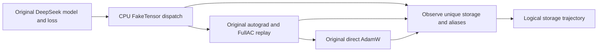

# Original DeepSeek CPU step capture

The original DeepSeek model can now complete forward, chunked loss, backward,
FullAC recomputation and a direct AdamW update using CPU FakeTensors. A separate
explicit CPU/AOT diagnostic also completes a reduced-model step through the
original TrainingEngine, including its FSDP and optimizer paths. This closes
the model-operator gap and establishes selected engine paths. All-rank
distributed execution and compiled CUDA allocation coverage remain incomplete.

## What executes



The model uses its original MLA, MoE router, grouped GEMM, local token dispatcher,
shared experts and deterministic scatter. FullAC retains its original policy,
RNG preservation and early-stop behavior. Tensor values remain unknown; there
is no numerical CPU or GPU training computation.

Two explicit adaptations make this possible. Post-initialization capture omits
random parameter sampling while preserving buffer initialization. The attention
metadata contract runs the original FlexAttention higher-order operator and its
autograd metadata kernels directly, with its compilation wrappers disabled. It
does not replace attention with dense matrix multiplication. See the
[attention contract](ATTENTION_METADATA.md) and
[checkpoint observer](CHECKPOINT_CAPTURE.md) for the precise boundaries.

The storage observer follows backing storage rather than summing tensor shapes.
Aliases share a storage ID. Native autograd/checkpoint ownership determines when
the storage expires, checked at operator boundaries. Outer saved-tensor hooks
are supporting evidence; they do not enumerate every checkpoint-internal save.

## Reproduce

Use TorchTitan `607852350b41b4b280d8b8de6340f4847ed71c5e`. The local integration
checks use PyTorch 2.14.1. This differs from the pinned public NVIDIA 26.09
container's PyTorch `2.14.0a0+b2c75dd062.nv26.09`; passing local tests is not
container validation.
Read-only inspection of that exact cached container confirmed that
`torch.overrides.redispatch_function` and
`TorchDispatchMode.ignore_compile_internals` are present. This establishes API
availability, not successful execution in the container.

```sh
python -m titan_sim.torchtitan_adapter \
  --torchtitan-root /path/to/torchtitan --flavor debugmodel \
  --seq-len 16 --tokens 16 --capture-scope post_initialization \
  --attention-contract flex_metadata --full-ac --steps 2 \
  --output debug-fullac-two-steps.json

# Full parameter dimensions; still unsharded, with a small token workload.
python -m titan_sim.torchtitan_adapter \
  --torchtitan-root /path/to/torchtitan --flavor 671B \
  --seq-len 16 --tokens 16 --capture-scope post_initialization \
  --attention-contract flex_metadata --full-ac --steps 1 \
  --output full-671b-fullac-step.json

TORCHTITAN_ROOT=/path/to/torchtitan python -m unittest discover -s tests
```

The CLI retains native attention and strict initialization as defaults. The new
contract must be requested. Trace metadata records the adaptations, completed
step count, gradient-bearing parameter count, optimizer completion and coverage
exclusions. An unsupported operation produces `status=blocked` with its traceback.

## Execution evidence

| Run | Parameters | Steps completed | Parameter tensors with gradients | Attention forward / recompute / backward |
| --- | ---: | ---: | ---: | ---: |
| Original debug model | 33,014,016 | 2 | 72 of 72 in both steps | 12 / 12 / 12 |
| Original 671B model | 671,026,404,352 | 1 | 848 of 848 | 61 / 61 / 61 |

Both use 16 tokens, sequence length 16 and original FullAC. AdamW completed
every listed step. The full-model CLI trace contains 193,205 events and 30,971
unique storage records. These are gradient *metadata* checks, not numerical
gradient validation. Compact summaries bind each result to its trace SHA-256:
[debug](../results/cpu-step/debug-fullac-two-steps.summary.json) and
[671B](../results/cpu-step/full-671b-fullac-step.summary.json).

Generate an equivalent compact artifact from a new trace with:

```sh
python scripts/summarize_step_capture.py full-671b-fullac-step.json \
  --output full-671b-fullac-step.summary.json
```

## Explicit compiled-graph diagnostic

`AOTGraphCapture` in `titan_sim.compile_capture` implements PyTorch's
`ignore_compile_internals()` contract. Compiler tracing does not enter the
allocation observer. An explicit AOTAutograd backend then executes its generated
ATen graphs under the observer, with separate graph and execution records.
Forward graph outputs include the values AOT saves for backward; their real
storage ownership controls their lifetimes.

```python
from titan_sim.compile_capture import AOTGraphCapture

capture = AOTGraphCapture()
# Default upstream torch.compile calls are explicitly redirected to this
# semantic AOT backend within compile_scope; this changes the backend.
with capture.compile_scope(), capture:
    # Construct/execute the selected CPU compiled region here.
    ...
```

Tests check an actual compiled SwiGLU forward, FullAC recomputation and backward,
without duplicate compiler-tracing allocations. A numerical CPU check confirms
gradient parity and saved-storage survival until backward. Real CPU tensors and
CPU FakeTensors are supported; CUDA inputs are rejected before compilation.
Nondefault backend requests and unsupported Inductor options also fail explicitly.

This is a separate diagnostic, not enabled by the model-step CLI above. Its
backend differs from Inductor, so its buffers must not be presented as an
Inductor GPU allocation plan. Simply making the observer compiler-transparent
is insufficient: real CPU Inductor execution can hide all fused internal
operations, and the tested FakeTensor/default-Inductor fixture terminated in
native code. The base observer therefore keeps its original strict behavior.

Run the original TrainingEngine diagnostic in an isolated, GPU-hidden subprocess:

```sh
python scripts/probe_cpu_training_engine.py --cpu-diagnostic \
  --torchtitan-root /path/to/torchtitan --world-size 2 \
  --expert-parallel-degree 1 --seed 0 --output engine-rank0-fsdp2.json
```

This uses the reduced model, 16 tokens, strict routing and one step by default.
It emits a trace, compact summary, subprocess outcome and logs, and refuses to
overwrite an existing trace. The child has a 60-second timeout. Use a fresh
output path for each experiment. The production `project_engine` command's
native defaults are unchanged.

| Original engine diagnostic | Outcome | Evidence |
| --- | --- | --- |
| One rank, EP=1 | Step and optimizer complete; 22,078 events | [summary](../results/cpu-step/original-engine-aot-world1-ep1-complete.summary.json) |
| Rank 0, world size 2, FSDP=2, EP=1, seed=0 | Step and optimizer complete; 23,288 events | [summary](../results/cpu-step/original-engine-aot-world2-ep1.summary.json) |
| Rank 0, world size 2, EP=2, seed=0, strict routing | Stops at expert dispatch's data-dependent token-count read | [summary](../results/cpu-step/original-engine-aot-world2-ep2.summary.json) |

The FSDP=2 trace includes copy-in and reduce-scatter operations. A fake process
group does not establish matching network participation by other ranks. EP=2
requires actual expert routing counts for communication split sizes; unknown
FakeTensor values cannot supply them. Recorded routing or a declared conditional
scenario is required. No routing counts were fabricated in these strict probes.
The local upstream-enabled regression suite passes 292 tests.

## Remaining production gaps

| Boundary | Current evidence | Still needed |
| --- | --- | --- |
| Original model operators | Unsharded BF16 forward, backward, FullAC and direct AdamW | Production precision transforms and optimizer hooks |
| Distributed TrainingEngine | Reduced-model engine step at degree one and rank 0 with FSDP degree two, under explicit CPU/AOT adaptations | EP execution, all logical ranks, communication dependencies and full production configuration |
| Compilation | Original Flex HOP metadata is observed with its compiler disabled | Compiler-compatible observation, compiled region storage plans and saved-buffer ownership |
| Dynamic MoE routing | Original local router operations execute with unknown values | Observed or declared routing splits for distributed dispatch and imbalance scenarios |
| GPU memory | Logical exposed tensor storage and lifetimes | Kernel workspace, quantized caches, CUDA/NCCL allocations, streams and allocator behavior |
| Startup | Parameter shapes and persistent buffer initialization | Value-dependent sampling, loading and initialization memory peaks |

The original engine initially stopped because `torch.compile(fullgraph=True)`
rejected the allocation observer. The explicit AOT diagnostic now passes that
boundary while retaining the original compile-region selection and FullAC
policy. Its host-control adaptations record BF16x9 as intent, construct the
original small CPU rank maps outside FakeTensor observation, and supply an
opaque token for CUDA RNG save/restore bookkeeping. These do not implement
numerical BF16x9 or CUDA RNG. The sharded diagnostic also explicitly supplies
seed zero; otherwise original seed broadcast requires reading an unknown value.

Backward callbacks need the CPU device normalizer to remain active. The
normalizer now uses PyTorch's public `redispatch_function` API to preserve that
context while executing the original Tensor and functional backward methods.
Without it, FSDP gradient-buffer factories escape into FakeCUDA and trigger a
native CUDA device-guard failure. Tests exercise both backward APIs and retain
their input, graph-retention and higher-derivative behavior.

Consequently, a completed unsharded step must not be divided by the GPU count
to claim per-device memory. FSDP gathers, expert partitioning, communication,
overlap and compiled storage reuse must determine each rank's lifetimes first.
This milestone alone does not establish whether the production recipe fits
192 GB, its CUDA reserved-memory peak, or its runtime.
