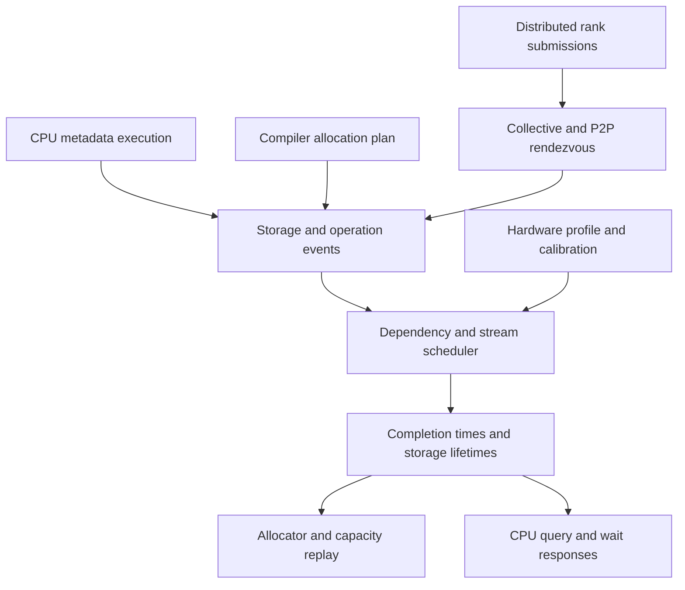

# Distributed execution, compiler plans, and runtime prediction

The simulator now has executable CPU paths for distributed rendezvous, upstream
pipeline schedules, compiler allocation plans, quantized storage, allocator
scenarios, and host waits. These are components of a training simulator. They
do not yet constitute a completed DeepSeek training run under the original
TorchTitan TrainingEngine.

## Simulator architecture

The CPU executes Python control flow and tensor metadata operations. Tensor
values and numerical GPU kernels are absent. A capture adapter or a compiler
plan supplies storage lifetimes, operations, streams, and dependencies. The
distributed adapter matches participating ranks and turns their submissions
into a shared communication event. The scheduler assigns completion times using
hardware rooflines, explicit network topology, supplied durations, or matching
GPU measurements. Allocator replay then uses the scheduled storage lifetimes.



`LiveExecution` connects submitted work to Python CUDA stream/event controls and
simulated distributed Work objects. An asynchronous launch returns immediately.
A device-side stream wait creates an ordering dependency. A CPU synchronization
advances the modeled host clock to completion; optional real-time pacing sleeps
only for the remaining modeled wait. CPU tracing overhead is excluded unless
the caller explicitly supplies a host duration. This bridge uses a coordinated
host clock and replays the accepted event prefix when a batch is submitted;
it is not yet an efficient large-scale incremental scheduler.

## Implemented components and boundaries

| Component | Executable behavior | Boundary |
|---|---|---|
| Distributed collectives | Match rank, group, sequence, dtype, reduction, and payload; one transfer plus per-rank completion; Work and Future interfaces | Supported APIs are explicit; numerical reductions are absent |
| CPU process launch | A registered backend initializes through `torch.distributed.init_process_group`; a Store exchanges control metadata between CPU workers | The initial multiprocess backend supports collectives; it is not an NCCL emulator |
| Pipeline schedule | Extract the actual upstream interleaved 1F1B schedule, lower forward/backward actions and P2P, retain activation buffers | Stage compute costs and buffer sizes are declared; this does not capture every model stage automatically |
| Compilation | Lower static physical slots, aliases, reuse, fused kernel costs, retained outputs, and graph replay pools | Compiler allocation plans and kernel costs must have explicit provenance; eager FX metadata cannot prove a GPU allocation plan |
| Quantized storage | FP8, MXFP8, and NVFP4 payloads, scale layouts, padding, conversion scratch, and persistent master/gradient/optimizer state | Layouts are explicit scenarios; this does not execute quantized numerical training or discover every torchao workspace |
| Allocators | Ideal allocation and configurable segment/block caching, rounding, splitting, coalescing, eviction, external usage, and private pools | These are allocator models, not an exact implementation of native CUDA caching or `cudaMallocAsync` |
| Runtime | Compute roofline or exact calibration, topology-aware communication, shared-resource serialization, stream dependencies and host waits | NCCL protocols, packet routing, GPU compute/communication interference and automatic CPU-overhead prediction remain outside this model |

The selected device profile controls capacity, bandwidth, and dtype-specific
compute ceilings. Tensor layout determines storage bytes. Changing GB200 to
GB300 does not by itself change those bytes, although different scheduling,
kernel selection, quantization policy, and allocator behavior can change the
peak. A different device needs its own matched calibration and topology.

See [allocator and network assumptions](ALLOCATOR_NETWORK_MODELS.md) and
[compiler and quantization contracts](COMPILED_QUANTIZED_MODELS.md) for input
schemas and unsupported cases. Unsupported cases should fail explicitly rather
than produce a plausible-looking timing or capacity verdict.

The [distributed guide](DISTRIBUTED.md) includes the registered backend and
functional-collective adapter. Functional collectives require this explicit
adapter because their native C++ wait path does not implement the simulator's
Python Work semantics.

## Memory and fit interpretation

The scheduler distinguishes host ownership from storage retained by unfinished
GPU work. The allocator distinguishes requested tensor bytes, occupied blocks,
reserved segments, inactive split bytes, and external device usage. An OOM can
occur despite sufficient aggregate free bytes because no usable block or new
segment is available. The replay stops the affected rank at that failed request.

Successful replay means **the recorded allocations fit under the selected
allocator assumptions**. It does not prove the full model fits. Missing kernel
scratch, communication buffers, graph pools, compiler plans, or rank behavior
still leave required capacity unknown. Historical iteration-level counters
cannot supply these lifetimes, so they are not fitted into this prediction.

## Validation path

Validation runs separately from simulation. CPU tests establish API behavior,
ordering, storage retention, allocator accounting, and rejection of unsupported
inputs. Container tests establish compatibility with the selected PyTorch build.
Small real GPU runs supply exact kernel measurements and independent held-out
timings. A matched full-model run is a further validation level.

The GEMM collector measures a CUDA-event interval around an eager operator.
That interval can include device idle while the CPU issues work. It should not
be interpreted as isolated kernel service time or combined with a second copy
of the same launch overhead. Held-out repetitions test that same measurement
boundary and hardware/software context.

```sh
python -m unittest discover -s tests
python scripts/distributed_probe.py --multiprocess --out results/distributed
python scripts/generate_compiled_quantized_example.py

# Actual GPU required; no full-model accuracy claim follows from this probe.
python scripts/calibrate_matmul.py --hardware profiles/gb200.json \
  --torchtitan-commit 607852350b41b4b280d8b8de6340f4847ed71c5e \
  --output results/calibration.json
```

The native metadata DeviceGuard probe is deliberately isolated in a subprocess
with GPUs hidden and an allocation trap. It investigates whether native autograd
can traverse fake CUDA tensors without touching a GPU. It is diagnostic support,
not a production replacement for CUDA device, stream, allocator and event APIs.

## Remaining full-model work

The original TrainingEngine still needs a complete metadata-only execution path
through its native CUDA/autograd controls, actual FSDP hooks and buffers,
compiler regions, dynamic MoE routing, and all logical ranks. The pipeline
schedule adapter and collective backend provide pieces of that path; they do
not automatically connect all those upstream internals.

A precise DeepSeek-V3 memory trajectory additionally requires every relevant
physical allocation and lifetime, including optimizer initialization, compiler
scratch, communication storage, and any graph-private pools. Runtime accuracy
requires matching kernel and collective calibration and independent evaluation.
The 256-GB200 selected recipe has not yet supplied a matched CPU projection and
GPU trajectory. That remains the acceptance gate for claiming full-model
accuracy, regardless of how many component tests pass.

The [execution results](validation/EXECUTION_EXTENSION_RESULTS.md) now include
226 passing tests on both CPU and the target container, actual CUDA compiler
plan import, an independently checked 512-byte allocation delta for a tiny
compiled forward, and three held-out eager-GEMM timing comparisons. They also
record the native CUDA-hooks backward blocker and the excluded memory baseline.
