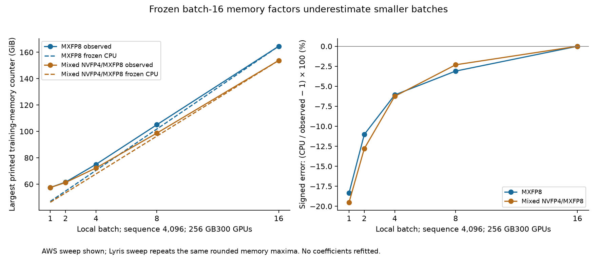

# CPU memory-model validation against the expanded DeepSeek logs

Follow-up: [the memory-gap diagnosis](MEMORY_GAP_DIAGNOSIS.md) resolves V3's
counter semantics against the full historical revision and evaluates a new,
bounded batch estimator. The frozen baseline results below remain unchanged;
their earlier counter-definition uncertainty is superseded for the audited V3
revision only. V4 metric/reset uncertainties remain.

## Abstract

The expanded logs show that the current CPU memory model is useful near its calibration configuration but does **not** accurately extrapolate to small batches. With the existing coefficients frozen, DeepSeek-V3 batch-1 memory is underestimated by **18.3% for MXFP8** and **19.5% for mixed NVFP4/MXFP8**. At batch 8 the corresponding errors fall to 3.1% and 2.3%; the separate batch-16 runs reproduce the calibration values at printed precision. The rounded planning factors also underestimate every tested batch below 16, so their rounding is not an adequate capacity margin.

For V4, the CPU implementation reproduces the byte counts of explicitly logged stash buffers. Transferring the previously fitted allocator ratios to a separate run gives reserved-memory errors up to **5.24%**, conditional on supplying that run's measured current allocated memory. This validates neither a prediction of current allocation nor a complete model trajectory. The full TorchTitan metadata execution path has not become validated merely because these historical logs are available.

No factors were refitted to the expanded collection. This assessment distinguishes frozen-model counter comparisons, conditional allocator-ratio comparisons, and replay of observed buffer geometry.

## Collection audit and selection

The input is `deepseek-v3-v4-training-logs-expanded-20261014`. Every manifest entry was resolved and checked against its SHA-256. Fifteen entries refer to content stored under `duplicate_of`; these are aliases, not missing logs or additional independent experiments.

| Audit item | Result |
|---|---:|
| Manifest entries verified | 2,613 |
| Unique stored files verified | 2,598 |
| Declared duplicate entries | 15 |
| Files with recognized training-memory, allocator, or stash records | 240 |
| Files containing the exact full-V3 parameter count | 65 |
| Full-V3 count candidates by pipeline degree | 54 PP1; 5 PP2; 6 PP4 |
| Detailed V3 frozen-model comparisons | 24 files: 22 separate logs and 2 original calibration logs |
| Detailed V4 comparison | Original run 2568526 and separate run 2565249 |

These are file counts, not counts of independent runs. The collection includes repeated rank output, reduced models, other model families, unsuccessful attempts, and logs without usable memory counters. The census does not promote a model name or path label into a verified configuration. Detailed validation selects the closest V3 package/configuration cohort and checks its runtime messages. The remaining candidates remain in the audit without invented prediction errors.

The [archive audit](validation/expanded_logs/archive_audit.json) records the verified sources and candidate configurations. The [selected observations](validation/expanded_logs/selected_observations.json) retain field and counter source lines. No raw logs, environment dumps, hostnames, or credentials are copied into this report's evidence extracts.

## Verified configuration scope

| Configuration item | V3 comparison cohort | V4 comparison pair |
|---|---|---|
| Model | DeepSeek-V3 671B; exact logged count 671,026,404,352 | 61 layers, hidden 7,168, 128 attention heads, 384 experts, top-k 6; the earlier audit identifies V4 Pro and reports 1,637.42B total parameters |
| Framework | TorchTitan 0.2.2+gita615ec2 | Megatron-Bridge/Core |
| Hardware | Runtime CUDA capacity identifies GB300, 276.62 GiB | GB300-labelled experiment; exact per-device hardware/capacity identity remains unverified |
| Parallelism | PP1, TP1, CP1, EP64, dense FSDP256, DP replicate 1; 256 GPUs derived from mesh | TP1, PP4, VPP4, EP64, expert TP1; matching logged stage layout |
| Input | Sequence 4,096; local batch 1, 2, 4, 8, or 16; global batch = 256 × local batch; one accumulation step | Sequence 4,096; microbatch 1; global batch 4,096 |
| Precision | Runtime conversion records distinguish MXFP8 and mixed NVFP4/MXFP8 | MXFP8 recipe; BF16 parameter/main-gradient defaults; earlier bucket audit identifies FP32 gradient exceptions |
| Recompute and compilation | FullAC; compiled loss and each transformer block | Selective `mla_up_proj`/`mhc` recomputation; `core_attn`/`attn_proj` offload; forced routing balance; full-iteration CUDA graphs |
| Numerical/execution evidence | No NaN-gradient or OOM indicators in the selected parsed observations. All AWS sweep logs report training completion; three Lyris sweep excerpts omit it. | Both runs report NaN gradient norms from iteration 2. Resource comparisons remain usable; valid training is not established. |

For V4, 22 explicit configuration fields match between the two logs; their values and line anchors are in [results](validation/expanded_logs/results.json). This is a check of those fields, not proof that every environment variable, compiler build, allocator option or kernel selection matches. For V3, an abbreviated package suffix does not establish the full immutable source tree or the exact PyTorch version. The original user-selected BF16/context-16K recipe remains outside this evaluation.

## Frozen-model methodology

The CPU estimator from the preceding implementation was called directly. Its state proxy and runtime coefficients were not modified:

\[
\widehat M(B)=S+\gamma A(B),\qquad
S=39.0588774\ \mathrm{GiB},\qquad
A(B)=61\times B\times4096\times7168\times2\ \mathrm{bytes}.
\]

The frozen coefficients are 2.350934381106 for MXFP8 and 2.148779814361 for mixed NVFP4/MXFP8. The rounded planning alternatives are 2.4 and 2.2. `S` still assumes FP32 parameters, FP32 gradients and two FP32 Adam moments evenly sharded across 256 GPUs. `A` remains an assumed BF16 checkpoint-boundary proxy. Their components are not independently measured by the aggregate counter.

Changing batch size updates the checkpoint proxy and explicitly invokes the estimator's extrapolation mode. Other known hardware, model, mesh, sequence, precision and compilation fields must match. Missing or conflicting configuration records are rejected. Predictions are compared with the largest retained training-memory counter in each log:

\[
\mathrm{error}=100\left(\frac{M_{\mathrm{CPU}}}{M_{\mathrm{log}}}-1\right).
\]

A negative error means underestimation. These comparisons use the same printed GiB counter convention; its allocated/reserved/peak API and reset window are still unverified. We therefore measure empirical counter generalization, not minimum required GPU capacity. Exact source-hash matches to calibration logs are labelled calibration replays. Normalized training-metric signatures also distinguish rewrapped copies from separate metric sequences. Separate job/file identity alone does not prove statistical independence.

## V3 results

The AWS batch sweep below contains separate files unused in fitting the original factors. The Lyris sweep reports the same rounded memory maxima at each precision/batch point and the same resulting errors; it is retained separately in the JSON rather than used to inflate a statistical sample count.

| Local batch | MXFP8 observed | MXFP8 CPU | Error | Mixed NVFP4/MXFP8 observed | Mixed CPU | Error |
|---:|---:|---:|---:|---:|---:|---:|
| 1 | 57.43 GiB | 46.90 GiB | **−18.33%** | 57.43 GiB | 46.23 GiB | **−19.51%** |
| 2 | 61.53 GiB | 54.74 GiB | −11.03% | 61.23 GiB | 53.40 GiB | −12.80% |
| 4 | 74.99 GiB | 70.43 GiB | −6.08% | 72.25 GiB | 67.73 GiB | −6.25% |
| 8 | 105.06 GiB | 101.80 GiB | −3.10% | 98.69 GiB | 96.40 GiB | −2.32% |
| 16 | 164.54 GiB | 164.54 GiB | 0.00% | 153.75 GiB | 153.75 GiB | 0.00% |

Values use unrounded calculations before presentation. At batch 1, the missing allowance is **10.53 GiB** for MXFP8 and **11.20 GiB** for mixed precision. Rounding the coefficients upward only changes their errors to −18.05% and −19.21%. Even at batch 8 the rounded versions remain low by 1.86% and 0.93%.



*This is a counter-versus-batch comparison, not a memory-versus-time trajectory. Lines connect tested configurations for readability. The coefficients were fitted previously at batch 16 and were unchanged during evaluation.*

The practical conclusion is that the current model is missing behavior that becomes relatively important at small batch sizes. Fixed buffers, materialization/workspace floors, baseline-state error, and batch-dependent kernel or graph choices are plausible contributors. The logs do not isolate which dominates. A factor fitted at batch 16 implicitly spreads any fixed missing storage across the activation proxy; reducing the proxy then incorrectly reduces that portion of the allowance too.

The next model correction should separate a fixed runtime allowance from batch-dependent storage, while retaining precision/backend-specific effects. That correction requires a new fit/evaluation split. It has deliberately not been fitted to these validation points and then reported as improved held-out accuracy. The batch-16 agreement validates repeatability of the printed total under the reviewed settings, not correctness of every modeled component.

## V4 allocator transfer and component checks

The original V4 profile uses run 2568526. Its same-rank, same-iteration ratios were applied to run 2565249. The input current allocation comes from the new log, so this is a **conditional allocator-overhead test**, not a CPU prediction of allocated memory itself. A common unknown unit divisor cancels in these ratios; printed GB values are not silently converted to bytes.

| Rank, after iteration 2 | New log: current allocated | CPU ratio estimate: maximum reserved | New log: maximum reserved | Error |
|---|---:|---:|---:|---:|
| 0 | 187.98 | 266.13 | 252.87 | **+5.24%** |
| 64 | 179.27 | 236.64 | 236.72 | −0.03% |
| 128 | 173.88 | 223.70 | 222.38 | +0.59% |
| 192 | 162.41 | 217.82 | 217.11 | +0.33% |

*All three memory columns retain the logger's unverified GB convention.*

Across iteration-1 rows, absolute errors are at most 0.21%. Allocated and maximum-allocated counters agree at the printed precision across all eight paired rows. Reserved memory does not: rank 0 differs by 13.26 printed GB after iteration 2. This demonstrates that the same live/high-water allocation counters need not imply the same allocator reservation. The comparison cannot uniquely attribute that difference to fragmentation, caching policy or allocation order. It also does not validate later graph-pool memory: these counter samples precede graph capture.

Two CPU component checks were executed using the new V4 log:

| Check | CPU result | Logged geometry result | What it establishes |
|---|---:|---:|---|
| Replay five stash allocations as coexisting storage | 51,219,582,208 bytes | 51,219,582,208 bytes | Runtime engine accounts for declared backing-storage payload correctly. Coexistence and representative-rank assignment are scenario assumptions. |
| MXFP8 data plus scale layout | 7,100,694,528 bytes | 7,100,694,528 bytes | Quantization module reproduces the byte total under an explicit transposed orientation and scale alignment of 64. Backend allocation/layout equivalence is not established. |

The second check combines 6,885,408,768 data bytes and 215,285,760 scale bytes. These are observed-geometry reconciliation checks. They must not be described as independent predictions of allocations or full-model peaks.

## Runtime and full-execution coverage

The V4 logs report median iteration times of **20.586 seconds** for run 2565249 and **20.604 seconds** for run 2568526 over iterations 10–50. These are observed runtime summaries, not CPU timing predictions. They show similar reported iteration durations alongside different early allocator reservations.

There is no complete matching CPU-captured training trace for these runs. The logs also lack the kernel/collective dependency and allocation-lifetime detail needed to reconstruct such a trace independently. Consequently, this work does not establish full-model runtime error, pipeline-schedule fidelity, compiler-workspace fidelity, all-rank peak memory, or OOM prediction. PP2/PP4 and reduced-model candidates are visible in the archive census; the V3 PP1 coefficients are not applied to them.

The verification result is therefore specific: **empirical batch scaling fails at small batches; V4 allocator ratios are approximate; declared storage accounting reconciles.** Complete distributed CPU execution remains a separate implementation/validation task.

## Reproduction and implementation checks

From the repository root, with the expanded collection available locally:

```sh
python scripts/validate_expanded_logs.py \
  /path/to/deepseek-v3-v4-training-logs-expanded-20261014 --plot
python -m unittest discover -s tests
```

The validator checks full-model identity, precision conversion evidence, FullAC, compiled regions, hardware, mesh, batch arithmetic, package family, units and source overlap before reporting error. Eight added tests cover frozen coefficients, exposed underprediction, configuration rejection, calibration reuse, repeated metric records and manifest duplicate resolution. Passing these tests verifies the validation machinery; it does not convert the measured prediction errors into a passing accuracy result.

The [results](validation/expanded_logs/results.json) retain profile fingerprints, configuration mismatches, source lines, signed errors and component checks. The original calibrated profiles are unchanged. Source revisions and unknown metric semantics remain visible rather than being filled in from the current TorchTitan checkout.
