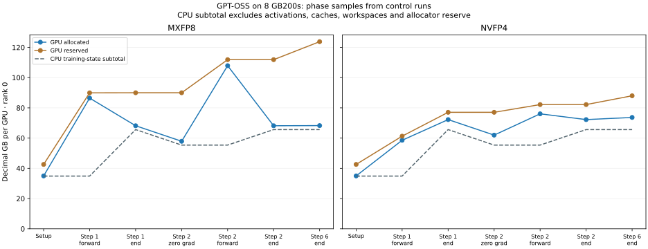

# GPT-OSS Allocation Lifetime Experiment

## Principal Finding and Experiment Status

The FP32 optimizer gradients in the reviewed GPT-OSS logs are ordinary live
training state at the logging point. Their retention is an implementation choice,
not evidence of a leak and not a mathematical requirement of Adam. The next
training step clears them before its forward pass. A different implementation
could release them after their last use, provided asynchronous work and CUDA
graph replay remain correct. That may reduce memory between steps without
reducing the maximum memory needed during a step.

**All eight full-model diagnostic runs completed six training steps on Ptyche.**
Four and eight GB200 GPUs were tested with MXFP8 and NVFP4, each with a control
and a detailed allocation capture. The measured optimizer-gradient storage
falls from 20.495 GB to zero on four GPUs, and from 10.248 GB to zero on eight
GPUs, at the next training step's clearing operation. It is recreated before
Adam. This directly confirms the expected lifetime.

The captures identify quantized caches, allocator block slack, dummy gradient
buffers, GEMM workspaces and a subset of external HybridEP allocations. Freezing
the four-GPU overhead components and changing only CPU optimizer sharding
predicts eight-GPU current allocation within **0.44% for MXFP8 and 0.59% for
NVFP4**. This is a retrospective transfer check for these matched recipes,
not a universal accuracy claim or a complete peak-memory predictor.

Setup job **3047725**, four-GPU job **3047840**, and eight-GPU job **3047728**
completed successfully on October 14, 2026. Each training job ran four cases.
An initial pilot, 3047758, reached model/optimizer setup but stopped before
forward because fast dataset-cache flags tried to load absent mock-data index
files. Disabling those dataset shortcuts resolved the failure without changing
the model, dispatcher, precision policy or optimizer. The earlier small Adam
preflight remains a separate sanity check; full-model results below supersede
it as evidence for gradient lifetime.

## Model and System Configuration

The GPU reference path executes Megatron-Bridge, matching the framework of the
archived GPT-OSS logs. The CPU simulator uses the verified TorchTitan parameter
inventory and reviewed storage/lifetime rules. These completed GPU validation
runs do not close the separate limitation in CPU capture of the full quantized
training execution path.

| Configuration item | Diagnostic setting |
|---|---|
| Model | GPT-OSS 20B, 24 layers, hidden/FFN size 2,880, 32 experts, top 4 |
| Attention and vocabulary | 64 query heads, 8 KV heads, head size 64; vocabulary 128,256 |
| Parameter count | 20,495,244,864 globally; 6,157,545,024 per model rank |
| Hardware | One or two Ptyche nodes, four or eight GB200 GPUs; 197,897,617,408 device bytes per GPU in preflight |
| Parallelism | TP=1, PP=1, CP=2, EP=4, expert TP=1; distributed Adam |
| Batch | Sequence 8,192, microbatch 1, global batch 2 or 4; one microbatch per step |
| Precision cases | MXFP8; NVFP4 with the recipe's last four BF16 layers |
| Execution | Six steps, random initialization, mock inputs, HybridEP, recipe CUDA graph settings |
| Checkpointing and graphs | `recompute_granularity=None`; MXFP8 full-iteration graphs; NVFP4 Transformer Engine module graphs |
| State storage | BF16 parameters and full gradient buffers; FP32 master weights, Adam moments and optimizer-gradient shards |
| Control | Same case with phase counters but without allocation history, snapshots or native allocation logging |
| Detailed capture | Allocator history and storage inventories on ranks 0 and 1; counters and native HybridEP logs on all ranks |
| Public container | `nvcr.io/nvidia/pytorch:26.09-py3`, aarch64 |
| Verified runtime | PyTorch `2.14.0a0+b2c75dd062.nv26.09`, CUDA 13.4, NCCL 2.31.2, Transformer Engine `2.19.0+5e52befd` |

The recipe comes from the archived 72-GPU configuration family. Reducing the
world size and global batch changes optimizer sharding, so this is a fresh
diagnostic, not an exact replay of the archived run. The original 8-GPU MXFP8
case reported a 267.0 GB allocated peak and is not a feasible starting point
on a 197.9 GB device. EP=4 and CP=2 reduce the local model/activation burden;
both tested configurations completed on the GB200 devices.

## Independent CPU Estimate

The CPU model reuses the previously verified parameter inventory and applies
the new parallel groups without GPU measurements as inputs. For this case,
dense optimizer state is sharded eight ways and expert optimizer state two
ways. All amounts below are decimal GB per GPU, without bucket padding.

| Allocation category | CPU estimate |
|---|---:|
| BF16 parameters | 12.3 GB |
| BF16 gradient buffers | 12.3 GB |
| FP32 master weights and two Adam moments | 30.7 GB |
| Persistent subtotal | **55.4 GB** |
| Additional FP32 optimizer gradients | **10.2 GB** |
| Subtotal after an optimizer step | **65.6 GB** |

These totals exclude activations, quantized caches, workspace, communication
storage, graph pools and allocator reserve. They cannot establish training
peak memory or the minimum device capacity required to run.

For the four-GPU pilot, dense optimizer state is sharded four ways and expert
optimizer state is unsharded. Its persistent subtotal is **86.1 GB** and its
post-step subtotal is **106.6 GB**, including **20.5 GB** of FP32 optimizer
gradients. These are separate predictions, not an accuracy comparison against
the eight-GPU case.

## Training Results and Allocation Categories

All amounts below are decimal GB. Current allocation is **rank 0 after step
2** from the control run. Peak columns are the **maximum across every rank**
over the six-step control run; they are not iteration-local reset counters.

| GPUs | Recipe | CPU state subtotal | GPU current allocated | Maximum peak allocated | Maximum peak reserved |
|---:|---|---:|---:|---:|---:|
| 4 | MXFP8 | 106.6 | 109.5 | 140.0 | 165.4 |
| 4 | NVFP4 | 106.6 | 113.6 | 120.5 | 127.8 |
| 8 | MXFP8 | 65.6 | 68.2 | 108.9 | 123.8 |
| 8 | NVFP4 | 65.6 | 72.2 | 83.3 | 91.3 |

The CPU subtotal is close to current allocation because it includes the live
training state. It is much lower than the training peak because it excludes
saved activations and temporary execution storage. Reserved memory also includes
inactive allocator blocks and graph-related retention. Neither peak reserved
nor current allocation is the minimum device capacity needed to run.

The detailed captures resolve the eight-GPU current allocation as follows.
More precision is shown here to make smaller components visible. These values
are **rank 0 after step 2** from the traced runs, before graph setup completes.

| Component | MXFP8, GB | NVFP4, GB | Evidence |
|---|---:|---:|---|
| CPU training-state subtotal | 65.621 | 65.621 | Independent parameter census and sharding rules |
| Tensor-storage correction | 0.000003456 | 0.000003456 | Difference between owned storage and unpadded CPU subtotal |
| Retained quantized caches | 1.315 | 5.084 | Directly identified backing-storage addresses |
| Dummy weight-gradient allocations | 0.842 | 0.842 | Live allocation stacks in TE's `get_dummy_wgrad` |
| GEMM workspaces | 0.201 | 0.235 | TE workspace helpers and PyTorch cuBLAS workspace allocation stacks |
| Other requested storage | 0.042 | 0.036 | Remaining requested bytes; includes routing metadata and smaller buffers |
| Allocator block slack | 0.137 | 0.412 | Active block size beyond requested size |
| **Measured allocated total** | **68.158** | **72.229** | Reconciles exactly before display rounding |

The two evidence types should remain distinct: tensor inventory identifies a
current storage owner; an allocation stack identifies the function that created
the allocation. The latter provides strong functional evidence for dummy
gradients and workspace, but the analyzer preserves these as stack-based labels.
The largest dummy gradient allocation is 738,754,560 bytes, matching the BF16
storage size of the 128,256-by-2,880 vocabulary projection. Megatron uses TE's
dummy-gradient helper with fused weight-gradient accumulation, separately from
the real BF16 gradient buffer and FP32 optimizer gradient shard.

The native HybridEP probe additionally records **113,246,208 bytes** of live
fabric allocations per GPU at this point in both recipes. The underlying
requests total 98,437,656 bytes; fabric alignment accounts for 14,808,552 bytes.
This is outside the PyTorch allocated total and covers only the instrumented
HybridEP allocator. It does not explain every external CUDA or NCCL allocation.

NVFP4 has more retained cache storage here, while MXFP8 has the larger training
peak. These are different complete execution recipes: their graph policies,
operation fusion and BF16 layer exceptions differ. The result should not be
attributed to numerical bit width alone.

## Gradient Lifetime and Graph Transition

For the first two ordinary training steps, the snapshots identify the following
optimizer-gradient storage around the clearing operation:

| GPUs | Before step 2 clearing | After both optimizer groups clear | Recreated before Adam |
|---:|---:|---:|---:|
| 4 | 20,495,244,928 bytes | 0 bytes | 20,495,244,928 bytes |
| 8 | 10,247,622,464 bytes | 0 bytes | 10,247,622,464 bytes |

This includes the dense and expert optimizer groups. Changes in the allocated
counter are slightly larger because the allocator also releases block slack.
Reserved memory can remain high after tensor storage is freed.

The graph transition matters separately. MXFP8's observed peak first appears
in the second forward pass, after the old optimizer gradients have been freed.
NVFP4's peak first appears between the end of step 2 and a subsequent clearing
hook during graph setup. Earlier gradient cleanup may therefore have different
effects on the two recipes. This experiment did not move the cleanup operation,
so it does not establish the saving that such an optimization would produce.

The recorder's step field is the latest training callback step. Additional
hooks during graph setup between steps 2 and 3 can therefore still carry step
2. Gradient-release comparisons use the first clearing sequence before the
ordinary step-2 forward pass, not those later graph-setup hooks.

The figure connects phase samples from control runs; it is not a continuous
memory trace. The CPU curve represents only modeled training state. Later
graph replay does not validate an eager allocation/free schedule automatically.

## Transfer to a Different Optimizer Shard Count

The four- and eight-GPU cases keep the same model partition, microbatch,
sequence, precision recipe and runtime. Increasing world size doubles each
optimizer sharding group while retaining the same per-rank model shapes.
That makes fixed per-model-rank overhead a more appropriate hypothesis than
scaling all overhead in proportion to Adam state.

For each precision, freeze the four-GPU measured component amounts, including
its allocator slack, and add them to the independent eight-GPU CPU subtotal.
No eight-GPU memory counter enters that prediction.

| Recipe | CPU state plus frozen four-GPU overhead | Measured eight-GPU current | Error |
|---|---:|---:|---:|
| MXFP8 | 68.460 GB | 68.158 GB | +0.44% |
| NVFP4 | 72.654 GB | 72.229 GB | +0.59% |

Retained caches, dummy gradients and GEMM workspaces are unchanged between the
two world sizes. Most of the remaining error is allocator slack: 0.439 to
0.137 GB for MXFP8, and 0.837 to 0.412 GB for NVFP4. Optimizer shard sizes change
the allocation sizes and reuse pattern. This supports modeling named components
and their lifetimes, instead of using a universal percentage multiplier.

This transfer is retrospective, with one target run per precision, and applies
only to current allocation at this reporting point. It is not validation across
different sequence lengths, EP/TP partitions, hardware generations, allocator
policies or models. It does not supply a peak-memory capacity guarantee.

## Observation Effects and Rank Coverage

MXFP8 rank-0 allocated and reserved peaks agree exactly between control and
traced runs at both world sizes. NVFP4 is not identical: on eight GPUs, rank-0
peak allocated changes from 79.091 to 79.029 GB, while peak reserved changes
from 87.986 to 87.606 GB. Snapshot collection also slows selected steps, so
traced step times must not be used directly for runtime calibration.

All ranks have phase counters, but only ranks 0 and 1 have detailed snapshots.
The largest eight-GPU NVFP4 control peak occurs on rank 3: **83.288 GB**, versus
**79.091 GB** on rank 0. This difference is material for capacity planning.
The experiment has not attributed rank 3's additional peak storage; a targeted
follow-up capture would be needed for that explanation. The maximum sampled
device usage across ranks was 131.049 GB for eight-GPU MXFP8 and 98.583 GB for
eight-GPU NVFP4. Those are sampled device observations, not continuous physical
memory peaks or minimum-capacity measurements.

The [comparison data](validation/gpt_oss_probe/experiment_comparison.json)
contains all rank counters, effective configurations, source/target calibration
components and gradient-release checks. The
[comparison script](../scripts/compare_gpt_oss_allocation_runs.py) reconstructs
CPU state, checks every rank completed six steps, and generates the figure.

## Measured Setup Allocation Breakdown

The first pilot provides a useful setup measurement even though training did
not run. At this phase, Adam's two moments and optimizer gradients have not yet
been created. The CPU estimate therefore includes only model weights, BF16
gradient buffers and FP32 master weights: **45.125424960 GB per GPU**.

| Rank 0 setup quantity | Measured bytes | Meaning |
|---|---:|---|
| Parameter storage | 12,315,091,712 | Directly identified tensor backing storage |
| Model gradient buffers | 12,315,091,712 | Directly identified backing storage |
| FP32 master weights | 20,495,244,928 | Directly identified optimizer storage |
| Allocator block slack | 208,588,500 | Active block size beyond its requested size |
| Other requested storage | 172 | Unattributed requested bytes, mostly small scalar allocations |
| Total current allocated | **45,334,017,024** | Sum of the five preceding categories |
| Inactive allocator space | 4,630,629,376 | Cached blocks, separate from active-block slack |
| Total reserved | **49,964,646,400** | Allocated plus inactive in this snapshot |
| Device-wide used | **53,806,170,112** | Whole-device observation; not a process-specific breakdown |

The three identified training-state categories exceed the ideal CPU subtotal
by only **3,392 bytes**. Another **208.6 MB** is explained directly by the
allocator's block/request metadata. For example, a 66,355,200-byte master-weight
request occupies a 67,108,864-byte block. This separates allocator slack from
quantized caches or workspaces, rather than fitting all of it to a generic
overhead multiplier. The remaining 172 requested bytes are not assigned a
tensor owner by the current inventory.

Device-wide usage exceeds PyTorch reserve by **3.8 GB** at setup. Before model
setup, device-wide usage was already about **1.5 GB** with zero PyTorch
allocation. These are useful residual observations; they do not establish how
much is CUDA context, NCCL or another external allocation.

Two non-default allocator pools already hold parameter/gradient storage before
training or graph capture. The reviewed DDP implementation creates pools for
NCCL user-buffer allocation when `nccl_ub=True`. A non-default pool must not
automatically be classified as CUDA graph memory, and parameter storage in
such a pool must not be counted again as an independent communication buffer.
The [setup attribution](validation/gpt_oss_probe/setup_attribution.json) retains
the per-pool observations and exact storage accounting.

## Measurement and Attribution

The recorder samples before model setup, after model/optimizer setup, around
forward, around creation of the FP32 optimizer gradients, around Adam, and at
step boundaries. The next step's `zero_grad` provides the direct lifetime test.
Later step boundaries cover the transition beyond two warmup steps into CUDA
graph capture/replay if the configured training path succeeds.

| Memory category | Evidence collected | Interpretation |
|---|---|---|
| Parameters and model gradient buffers | Tensor backing-storage addresses and sizes | Exact ownership where storage intersects an allocator block; aliases counted once |
| Master weights, Adam moments, optimizer gradients | Optimizer storage inventory before/after lifetime boundaries | Tests the CPU state subtotal and release schedule |
| Retained quantized representations and scales | Known Transformer Engine workspace fields and allocation stacks | Direct field ownership when available; stack matches remain candidate labels |
| Activations and kernel storage | Allocation history, stacks, forward/backward boundaries | Locates transient allocations; a stack alone may not distinguish an activation from workspace |
| HybridEP communication buffers | Optional logging inside its external allocator | Requested sizes and fabric alignment; coverage excludes other direct CUDA allocation sites |
| Allocator reserve and delayed frees | Active, awaiting-free and inactive block states | Separates live tensors from cached blocks and stream-delayed reuse |
| CUDA graph/custom pools | Pool identifiers and capture/replay phase observations | An unfamiliar pool ID alone does not prove it is a graph pool |
| Other external memory | Device-wide usage alongside PyTorch reserve | Residual only; includes CUDA context/library/NCCL effects and is not exact NCCL attribution |

HybridEP's external allocator uses CUDA driver fabric allocations or direct
`cudaMalloc`, outside PyTorch's allocation ledger. The optional native probe
records only metadata, with no tensor values or explicit GPU synchronization.
For fabric allocations, it records the aligned allocation size. For `cudaMalloc`,
only the requested size is known; physical rounding is not inferred. Imported
peer mappings are not counted as new local physical memory.

The phase recorder saves the native log position alongside each sample so the
offline analyzer can reconstruct the tracked external allocation state at that
boundary. It does not add this subset twice to the device-wide residual.

Snapshots and Python storage inspection introduce host overhead. The control
run is therefore necessary to assess changes in observed peak and step time.
Neither run inserts an explicit synchronization at each sample. Counters and
snapshots are nearby observations, not a guarantee of simultaneous sampling
across streams or ranks. Peak counters retain their cumulative window; the
probe does not reset the framework's statistics.

## Reproducibility and Validation

The pinned public sources are Megatron-Bridge
`fcbb6031103d0ca845c1a54d4fee55ecfcca17b6`, Megatron-LM
`d0b3b775498a8ae6870075f1a5fc32bc260aa1b3`, and the Bridge Dockerfile's DeepEP
revision `34152ae28f80bcc3ee38d7a12cb2ad87cfd4ea72`. Native build adjustments
add CUDA CCCL headers, select C++20 for the container's PyTorch, and add optional
allocation logging. Training dispatch is not silently replaced with a different
backend. Python dependencies live in an isolated overlay; a runtime guard
checks that the container's installed GPU runtime versions remain unchanged.

The [launcher](../scripts/profile_gpt_oss.py) checks architecture and per-rank
parameter count, and writes the effective precision/graph configuration and
completion status. The [Ptyche scripts](../scripts/ptyche_gpt_oss/) preserve the
setup and launch procedure. Raw snapshots stay in the experiment directory on
Ptyche; only trusted, locally produced snapshots should be loaded by the
[offline analyzer](../scripts/analyze_allocation_snapshots.py), because the
snapshot serialization format is pickle.

The [CPU projection](validation/gpt_oss_probe/cpu_projection.json) and
[preflight evidence](validation/gpt_oss_probe/preflight.json) are retained.
The [updated preflight](validation/gpt_oss_probe/preflight-with-hybridep.json)
confirms the successful GPT-OSS and HybridEP imports after setup.
Unit tests cover overlapping storage owners, cross-device address isolation,
external allocation/free lifetimes, address reuse and fabric alignment. These
checks validate bookkeeping; they do not establish complete GPU allocation
coverage. The final suite ran 267 tests: 258 passed and 9 were skipped for
unavailable optional environments. Separately, every rank in all eight GPU
cases records all six training steps and a successful completion manifest.

Use the [evidence exporter](../scripts/export_allocation_evidence.py) to retain
selected rank-0 snapshots with all-rank counters. Omitted snapshots are marked
explicitly in its phase records; full raw captures remain on Ptyche. The
[Ptyche run guide](../scripts/ptyche_gpt_oss/README.md) records source pins,
launch commands and the limitations of these cluster-specific scripts.

The source explanation for the original gradient lifetime is independently
inspectable: Megatron's distributed optimizer copies reduced BF16 shards to
FP32 `.grad` before Adam and includes those master-parameter gradients in
`zero_grad(set_to_none=True)`. Bridge invokes that clearing operation at the
start of the next training step. The archived iteration-2 logging point lies
between those operations. A later CUDA graph execution path must be measured
separately before assuming the same allocation/free behavior.
