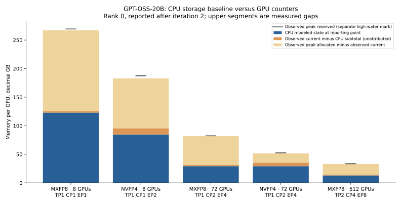

# GPT-OSS CPU Memory Projection and GPU Comparison

## Principal Finding

Subsequent [Ptyche allocation experiments](GPT_OSS_ALLOCATION_EXPERIMENT.md)
completed full GPU training on four/eight GB200s and directly measured several
previously unexplained components. They use new diagnostic configurations;
the archived-run comparisons below retain their original scope and values.

The CPU simulation reproduces the parameter inventory and partition sizes of all
five GPT-OSS benchmark runs. Its independent model of training state at the
reporting point accounts for 91%–98% of current allocated memory in the MXFP8
runs and 82%–89% in the NVFP4 runs. The remaining current allocation is substantial, and the training
peaks are substantially higher still. This establishes correct model sizing and
useful partial memory coverage; it does not establish a complete training-peak
prediction.

A separate empirical extension, calibrated on one 8-GPU run for each precision,
underpredicts current allocation on the three larger runs by 5.6%–7.4%. These
targets do not provide memory inputs to the prediction. This is a retrospective
transfer experiment, with only three evaluation cases, rather than a blind
accuracy guarantee. It applies to current allocation after iteration 2, not peak
memory or required device capacity.

## Model and System Configuration

These are Megatron-Bridge training logs. TorchTitan supplies the CPU model's
parameter shapes; the simulator applies the storage and partition rules reviewed
in the exact Megatron revisions recorded by the logs. It does not assume that
TorchTitan and Megatron execute the same kernels or retain the same activations.

| Configuration item | Verified setting |
|---|---|
| Architecture | GPT-OSS, 24 layers, hidden and expert FFN dimensions 2,880 |
| Attention | 64 query heads, 8 KV heads, head dimension 64; learnable sinks and alternating sliding/full attention |
| Experts | 32 experts per layer; top 4 routing; expert tensor parallelism 1 |
| Vocabulary | **128,256**, NullTokenizer, no padding; a synthetic benchmark vocabulary |
| Global parameter count | **20,495,244,864**, reconstructed on CPU and matched to the EP=1 log |
| Sequence and scheduling | Sequence length 8,192; PP=1; one microbatch per optimizer step |
| Parameter and gradient buffers | BF16; full local gradient buffer retained by distributed optimizer |
| Adam state | FP32 master weights and two FP32 moments, sharded across the appropriate data group; a separate FP32 gradient shard remains live at the reporting point |
| Execution | Overlapped gradient reduction and parameter gathering; HybridEP dispatch; quantized compute |
| Hardware | Archive grouping identifies these as GB300 candidates; the five log contents do not independently establish the GPU SKU |
| CPU execution environment | Local PyTorch 2.14.1; shape/storage execution, not a reproduction of the GPU container runtime |

The default TorchTitan vocabulary is 201,088. Leaving that default would add
419,512,320 parameters. Both embedding and output projection were adjusted to
the logged vocabulary before the census. The resulting global total is 20.495B,
not the 20.915B total produced by the default vocabulary.

| Compute | GPUs | TP / CP / EP | Microbatch / global batch | Parameters per model rank |
|---|---:|---|---|---:|
| MXFP8 | 8 | 1 / 1 / 1 | 3 / 24 | 20,495,244,864 |
| NVFP4 | 8 | 1 / 1 / 2 | 3 / 24 | 10,936,778,304 |
| MXFP8 | 72 | 1 / 2 / 4 | 1 / 36 | 6,157,545,024 |
| NVFP4 | 72 | 1 / 2 / 4 | 1 / 36 | 6,157,545,024 |
| MXFP8 | 512 | 2 / 4 / 8 | 1 / 64 | 3,079,983,936 |

Every parameter count in the last column is independently reproduced from the
CPU inventory. At TP=2, norms, router parameters and attention output bias remain
replicated. Dividing every dense parameter by TP would undercount 1,211,424
parameters per rank. Expert parameters follow their separate EP mesh.

The MXFP8 recipes request full-iteration CUDA graphs. The NVFP4 recipes request
Transformer Engine graphs for selected modules and keep the last four layers in
BF16. The logged `recompute_modules=['core_attn']` is not evidence of enabled
checkpointing: the reviewed default `recompute_granularity=None` remains in
effect. Likewise, a printed FSDP sharding-policy field does not enable FSDP;
the complete DDP configuration explicitly records `use_megatron_fsdp=False`.

## CPU Simulation Method

The simulator constructs the upstream GPT-OSS model on PyTorch's meta device,
records each parameter's shape, and applies the reviewed TP/EP placement. It
then emits allocation events for BF16 weights, BF16 gradient buffers, FP32
master weights, Adam's two moments, and the FP32 optimizer gradient shards.
Titan-sim replays these events on CPU, including release and re-creation of the
optimizer gradient shards in the second iteration. This covers setup and
training-state lifetimes, not intermediate forward/backward activations.

For local dense parameter elements D, local expert elements E, dense optimizer
group size Gd, and expert optimizer group size Ge, the unpadded subtotal is:

**Persistent core bytes = 4 × (D + E) + 12 × (D/Gd + E/Ge).**

**State at the report = persistent core + 4 × (D/Gd + E/Ge).**

The first term includes two bytes each for weights and gradients. The second
includes three FP32 tensors per optimizer-owned element. The extra term is the
FP32 optimizer gradient: Megatron copies the BF16 reduced shard with `.float()`
before Adam, retaining it until the next `zero_grad`. The report occurs after
the optimizer step and before that release, so excluding it mismatches the
measurement point. With PP=ETP=1, Gd is
world size divided by TP, and Ge is world size divided by EP. CP participates in
the dense optimizer group; it must not be divided out a second time. Shard
sizes use the mean, rounded upward by at most one element per group. Actual
bucket padding and per-rank shard imbalance remain outside this subtotal.

Neither GPU allocated counters nor fitted factors enter this calculation.
Quantized compute does not automatically make persistent parameters FP8/FP4:
the reviewed parameter-storage defaults and logged gathering flags leave these
weights in BF16. Additional quantized copies and scales are outside the subtotal.

## Independent Projection Results

All values below are **decimal GB per GPU**, using **rank 0 after iteration 2**.
The logger divides bytes by 1e9. Other reported ranks and both iterations are
preserved in the machine-readable results; this table is not an all-rank maximum.

| Compute / GPUs | CPU state at report | GPU current allocated | Unexplained current | Current shortfall | GPU peak allocated | GPU peak reserved |
|---|---:|---:|---:|---:|---:|---:|
| MXFP8 / 8 | 123.0 | 125.7 | 2.7 | 2.2% | 267.0 | 269.4 |
| NVFP4 / 8 | 84.7 | 95.6 | 10.9 | 11.4% | 182.8 | 187.4 |
| MXFP8 / 72 | 29.2 | 31.6 | 2.4 | 7.6% | 81.7 | 82.3 |
| NVFP4 / 72 | 29.2 | 35.4 | 6.2 | 17.5% | 51.5 | 52.5 |
| MXFP8 / 512 | 13.0 | 14.3 | 1.3 | 9.4% | 33.1 | 33.4 |



The CPU subtotal splits into the following categories. Values are rounded only
for display, so displayed components may not sum exactly.

| Compute / GPUs | Weights | BF16 gradients | Master weights plus Adam moments | FP32 optimizer gradients | Total at report |
|---|---:|---:|---:|---:|---:|
| MXFP8 / 8 | 41.0 | 41.0 | 30.7 | 10.2 | 123.0 |
| NVFP4 / 8 | 21.9 | 21.9 | 30.7 | 10.2 | 84.7 |
| Either precision / 72 | 12.3 | 12.3 | 3.4 | 1.1 | 29.2 |
| MXFP8 / 512 | 6.2 | 6.2 | 0.5 | 0.2 | 13.0 |

## Interpretation of the Gap

Three quantities should remain separate:

1. **Current allocation above modeled state:** 1.3–10.9 GB across these cases.
   Possible contributors include retained quantized weight representations,
   routing/communication buffers, padding, and persistent workspaces. Aggregate
   counters do not identify which allocation owns these bytes. These are
   candidates, not a measured component attribution.
2. **Peak allocated above current allocation:** 16.1–141.3 GB. This reflects a
   higher historical live-allocation level. Saved activations, dispatch buffers,
   and temporary kernel storage are plausible contributors, but the difference
   is not itself an activation measurement or a synchronized memory snapshot.
3. **Peak reserved above peak allocated:** 0.3–4.5 GB in the rank-0 comparisons.
   The peaks can occur at different times. Their difference is not an exact
   measurement of fragmentation. Nevertheless, allocated peaks themselves are
   already far above the CPU subtotal: allocator reserve alone cannot explain
   the missing training memory.

The two 72-GPU runs have identical modeled-state estimates. NVFP4 has higher
current allocation, 35.4 versus 31.6 GB, yet a much lower peak allocation, 51.5
versus 81.7 GB. A single universal overhead factor cannot represent both facts.
Precision, buffer lifetime, and execution policy must be modeled separately.

The logger reads current and peak allocator counters without resetting peaks
at each report. Treat them as high-water counters through that report, not
independent peaks for each iteration. No peak reset was found in the reviewed
Bridge/MCore source snapshots; dependencies can still affect counter windows.
For all three MXFP8 logs, full-graph capture completion appears after the
iteration-2 counter lines. Thus these counters do not validate the later graph
replay memory footprint. The TE recipe also schedules graph creation after its
two warmup steps, but these snapshots alone do not measure its eventual pools.

## Empirical Current-Allocation Transfer

For each precision, take the observed iteration-2 current allocation of the
8-GPU run and divide by that run's independent CPU state at the reporting point. Freeze this factor
and multiply it by each larger run's CPU subtotal. The factors are **1.0221 for
MXFP8** and **1.1281 for NVFP4**. No target memory counter is used in prediction.

| Evaluation run | Calibrated CPU current estimate | GPU current | Error, (estimate / measured − 1) |
|---|---:|---:|---:|
| MXFP8 / 72 GPUs | 29.83 GB | 31.60 GB | −5.61% |
| MXFP8 / 512 GPUs | 13.25 GB | 14.31 GB | −7.40% |
| NVFP4 / 72 GPUs | 32.92 GB | 35.38 GB | −6.95% |

This improves estimation of the current-memory baseline for this small cohort,
but the errors remain material.
It neither identifies the physical source of the overhead nor supplies the
missing training peaks. The factors should remain scoped to this model,
precision recipe, software family, and reporting point; they are not new
hardware-independent or cross-model constants. The architecture, dimensions,
vocabulary and storage policy were reviewed before selecting the calibration
and evaluation split, so this is explicitly retrospective.

As a diagnostic, fitting the factor against persistent core alone, omitting the
known FP32 optimizer gradients, produces deceptively closer transfer errors of
0.23%–1.72%. Those results are retained separately in the JSON. They do not make
the incomplete component model more correct: the fitted factor absorbs an
allocation whose size and lifetime we can calculate, together with other
unresolved terms. The final projection includes that allocation explicitly. A
better extension should model quantized caches and communication storage with
their own scaling rules instead of choosing the multiplier with the nicest fit.

## Dispatch Coverage and Next Implementation Work

An actual upstream FakeTensor forward/backward attempt was also run on CPU. It
stopped in the first attention layer with:

> FlexAttention does not support backward on CPU.

The check is reached during the forward call because training gradients are
enabled. The diagnostic uses unsharded eager BF16 and a scalar diagnostic loss;
it is not the quantized, compiled Megatron training recipe. Its incomplete trace
is not used as a full training-memory estimate. Removing the guard would not
supply Transformer Engine, quantization, dispatch, or CUDA graph allocation
behavior, so the guard was not bypassed.

The next useful extension is a supported metadata contract for training
attention and quantized grouped GEMMs, including saved tensors and packed
representations. Routing and communication buffers need explicit sizes and
lifetimes from the selected dispatcher. These contracts can then feed the
existing CPU event replay. GPU snapshots at post-DDP setup, post-optimizer
initialization, end-forward, backward peak, end-step, and post-graph capture
would let us attribute the residual rather than assign it to a guessed category.
Matching observations must include allocator-pool coverage: the logged NCCL
user-buffer option can use a custom memory pool, and neither these counters nor
the CPU subtotal represent all external device allocations.

## Reproduction and Evidence

Run from the repository with the original archive, the pinned TorchTitan
checkout, and the exact public Megatron-Bridge source snapshot:

```sh
python scripts/validate_gpt_oss.py /path/to/deepseek-v3-v4-training-logs-expanded-20261014 \
  --torchtitan-root /path/to/torchtitan \
  --bridge-source /path/to/Megatron-Bridge --attempt-capture --plots
python -m unittest discover -s tests
```

The script verifies log hashes, source revision markers, logger source hash,
storage policy, architecture fields, and per-rank counts. It writes the full
parameter inventory, logical state events, both iterations' observations,
source line numbers, calibration/evaluation provenance, CSV and plot. Raw logs
are not copied into this repository. `--plots` requires matplotlib.

Validation completed with **262 tests run: 253 passed and 9 skipped**. New checks
cover distinct dense/expert optimizer groups, the retained FP32 gradient
lifetime, every logged parameter count, unsupported topology rejection,
conflicting configuration evidence, and independence from target memory inputs.

- [Results and provenance](validation/gpt_oss/results.json)
- [CPU parameter inventory](validation/gpt_oss/parameter_inventory.json)
- [Comparison CSV](validation/gpt_oss/comparison.csv)
- [CPU predictor](../titan_sim/gpt_oss_memory.py)
- [Reproduction script](../scripts/validate_gpt_oss.py)
- [TorchTitan GPT-OSS shapes, pinned revision](https://github.com/pytorch/torchtitan/blob/607852350b41b4b280d8b8de6340f4847ed71c5e/torchtitan/models/gpt_oss/flavors.py)
- [Megatron parameter/gradient buffer ownership](https://github.com/NVIDIA/Megatron-LM/blob/d0b3b775498a8ae6870075f1a5fc32bc260aa1b3/megatron/core/distributed/param_and_grad_buffer.py)
- [Megatron optimizer state defaults](https://github.com/NVIDIA/Megatron-LM/blob/d0b3b775498a8ae6870075f1a5fc32bc260aa1b3/megatron/core/optimizer/optimizer_config.py)
- [Megatron FP32 gradient copy and release](https://github.com/NVIDIA/Megatron-LM/blob/d0b3b775498a8ae6870075f1a5fc32bc260aa1b3/megatron/core/optimizer/distrib_optimizer.py)
- [Bridge memory counter definitions](https://github.com/NVIDIA-NeMo/Megatron-Bridge/blob/fcbb6031103d0ca845c1a54d4fee55ecfcca17b6/src/megatron/bridge/training/utils/train_utils.py)

This work ran CPU projection and compared existing GPU evidence. It launched no
new GPU training job and makes no runtime, final graph-memory, or OOM-capacity
claim.
