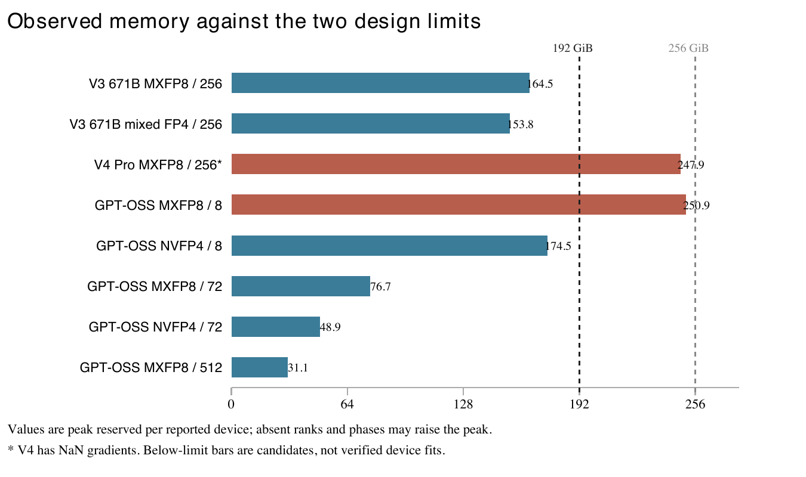
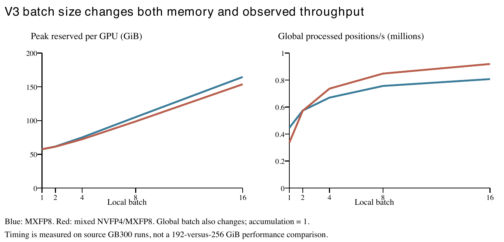

# Capacity impact of a 192 GiB RU design

## Summary

Reducing per-device HBM from 256 GiB to 192 GiB removes 25% of nominal capacity. The design could be economically favorable if lower system cost or power outweighs any loss in training throughput, but it can also force smaller batches, more partitioning, recomputation or offload. We built TitanSim to study these effects. This report combines supported CPU memory projections with configuration-matched GPU logs; it does not yet establish an optimized throughput comparison between the two designs.

Across eight selected full-model configurations, six have recorded framework peak reservation below 192 GiB, while two already exceed 192 GiB in live framework allocations. The two capacity-exceeding executions are V4 Pro and GPT-OSS MXFP8 on 8 GPUs. Their observed allocated-memory excesses are at least 35.0 and 56.7 GiB, averaging 45.8 GiB across those two cases. V4 has NaN gradients, so it provides resource-pressure evidence rather than a healthy training baseline. The six lower-memory cases are candidates for unchanged execution, not six validated device fits.

No measured average throughput loss, cost advantage or energy saving can yet be assigned to the HBM reduction. The case count is an equally counted, deliberately selected configuration set, not a frequency-weighted customer workload mix. V3 16B and the 4/8-GB200 GPT-OSS probes support estimator validation but are not extra headline cases; V4 repeats count once. Nemotron approximately 2.3T is excluded pending a verified architecture and matched run.

Figure 1. Largest observed framework reserved counter for each selected recipe. Values are normalized to GiB per reported GPU. Reserved includes allocated storage and cached blocks. Missing ranks, later phases and external allocations can increase actual demand; the two over-limit cases also exceed 192 GiB in allocated memory alone.

## Design assumptions and study scope

| Item | Setting and consequence |
|---|---|
| Capacity comparison | 192 GiB = 206.2 decimal GB; 256 GiB = 274.9 decimal GB. Both are nominal per-device limits. Usable capacity and operating reserve remain unspecified. |
| Controlled comparison | Hold compute, HBM bandwidth, links, GPU count and software constant to isolate capacity. An actual RU SKU may change these resources and needs a separate hardware profile. No NVL576 topology or bandwidth is inferred. |
| Training equivalence | A valid performance comparison preserves model, precision, sequence length, global batch and useful training work. Local batch, accumulation and parallelism may change only as explicit capacity remedies. |
| Evidence basis | V3 source runs use 256 GB300s reporting 276.62 GiB per device. V4 has 256 ranks; exact physical SKU/capacity is unverified. GPT-OSS archive device counts are verified; physical SKU is not. These are not measurements on the proposed RU. |

The primary capacities follow the manager’s GiB wording. This differs from the earlier decimal-GB study in tab 1. Under decimal 192/256 GB, the same two cases exceed the lower limit, but both also have recorded reservation above 256 GB. Under 256 GiB, all eight recorded reservation values are below the nominal upper limit. Neither observation establishes a complete-device fit.

## Methodology and agreement with measurements

First, identify each runtime recipe from its logs and source revision, including tensor dimensions, partitioning, optimizer, quantization, checkpointing and graph policy. Recheck source hashes and normalize counters only after verifying the logger’s unit divisor. This pass verified 27 archive logs, reran 32 V3 CPU projections without refitting profiles, and recomputed the reported calibration deltas. Printed log precision limits the numerical precision of the comparisons.

For V3 671B, the reported CPU model is a bounded piecewise-linear interpolation of peak reserved memory versus local batch, separately for MXFP8 and mixed NVFP4/MXFP8. Batches 1, 4 and 16 are calibration anchors; batches 2 and 8 are retrospective evaluation points. Other configuration fields are held fixed. The calibrated total already absorbs allocator-visible runtime costs; adding a second generic overhead factor would double count them. The 32 interpolations are not 32 independent validations.

For GPT-OSS, the CPU estimator derives parameter, gradient, master-weight and Adam-state storage from tensor shapes and the actual mesh. Allocation captures provide quantized-cache, workspace-candidate and allocator-slack terms. Frozen terms from 4 GPUs are tested at 8 GPUs with optimizer sharding recomputed. For V4, we can replay explicit buffer geometries and compare reservation behavior, but cannot independently predict the complete model peak. V4 capacity conclusions below therefore use observed GPU allocations.

TitanSim also has metadata capture, dependency scheduling and allocator replay, but this study does not yet supply complete production allocation sizes and lifetimes for every model/rank. A successful short CPU training step is distinct from a complete GPU-memory forecast. NCCL/native pools, hidden workspaces, graph capture, asynchronous reuse, initialization and checkpoint-saving coverage remain incomplete.

Required device capacity is the maximum simultaneous footprint over ranks and time: PyTorch reserved + non-overlapping external allocations + context/driver usage, with a declared uncertainty allowance. PyTorch allocated is already contained in reserved. Sum concurrent allocations at the actual peak; do not sum independent category peaks. A counter below the limit is a candidate; a recorded live allocation above the limit establishes that the observed execution needs a change.

| Comparison | Measured agreement | What confidence it supports |
|---|---|---|
| V3 671B reserved counter | Maximum excluded-batch error: 2.85% MXFP8; 1.86% mixed FP4. Batch 16 matches by calibration. | Within-profile counter interpolation only. No all-rank/device-wide confidence bound. |
| V3 16B separate profile | Maximum excluded-batch error: 2.20%. | Method transfers with separate calibration; 671B coefficients are not reused. |
| GPT-OSS NVFP4, 8 GB200 | State only: 65.621 vs 72.229 GB, −9.15%. Frozen components: 72.654 vs 72.229 GB, +0.425 GB / +0.59%. | Post-step rank-0 allocation, not transient peak. All values in this row are decimal GB. MXFP8 component-transfer error is +0.44%. |
| V4 Pro reservation ratio | Maximum error 5.24%, using target measured current allocation as an input. | Conditional allocator comparison, not independent memory prediction. Full-Pro unit conversion is now verified as decimal GB. |

Delta means estimator minus measurement. These checks are retrospective and their maximum errors are not statistical confidence intervals. The detailed per-model allocation report records component attribution and unresolved lifetime coverage. Full V4 Pro unit semantics above use the later historical-source audit, superseding the earlier unverified-unit label; the reduced V4 logs still have unresolved MB units.

## Detailed capacity results

V3 uses sequence 4096, full activation checkpointing, compiled blocks/loss and FSDP256. Its two selected cases use local batch 16 and global batch 4096. V4 Pro has 61 layers, 384 experts/top-6, sequence 4096, microbatch 1, global batch 4096, VPP4, selective recomputation, attention offload and full-iteration graphs. GPT-OSS has 20.495B parameters, vocabulary 128256 and sequence 8192; PP1 and expert TP1. Its local/global batches are 3/24 on 8 GPUs, 1/36 on 72 GPUs and 1/64 on 512 GPUs.

| Case and parallelism | Peak allocated | Peak reserved | Room at 192 | Room at 256 |
|---|---|---|---|---|
| V3 MXFP8; 256 GPUs TP1 PP1 CP1 EP64 | N/A | 164.5 | +27.5 | +91.5 |
| V3 mixed FP4; 256 GPUs TP1 PP1 CP1 EP64 | N/A | 153.8 | +38.3 | +102.3 |
| V4 Pro MXFP8*; 256 GPUs TP1 PP4 CP1 EP64 | 227.0 | 247.9 | -55.9 | +8.1 |
| GPT-OSS MXFP8; 8 GPUs TP1 PP1 CP1 EP1 | 248.7 | 250.9 | -58.9 | +5.1 |
| GPT-OSS NVFP4; 8 GPUs TP1 PP1 CP1 EP2 | 170.3 | 174.5 | +17.5 | +81.5 |
| GPT-OSS MXFP8; 72 GPUs TP1 PP1 CP2 EP4 | 76.1 | 76.7 | +115.3 | +179.3 |
| GPT-OSS NVFP4; 72 GPUs TP1 PP1 CP2 EP4 | 48.0 | 48.9 | +143.1 | +207.1 |
| GPT-OSS MXFP8; 512 GPUs TP2 PP1 CP4 EP8 | 30.8 | 31.1 | +160.9 | +224.9 |

Table 3. All numeric columns are GiB per reported GPU. Room = nominal capacity minus largest recorded reserved counter; it excludes unobserved demand and operating headroom. V3 ranks cannot be identified from repeated archived lines. V4 reports only 4/256 ranks after iterations 1–2. GPT-OSS observations cover 1/8, 2/72 or 8/512 ranks after iterations 1–2. These windows and rank sets are not full-run maxima. *V4 has unhealthy gradient norms.

V3 has 27.5 GiB counter-only room in MXFP8 and 38.3 GiB in mixed FP4 at the lower capacity. A batch reduction is not currently shown to be necessary. The mixed-precision result is a distinct training recipe, not a free optimization that preserves a fixed precision requirement.

The V4 repeats reach the same 227.0 GiB allocated peak but different reserved peaks, 235.5 and 247.9 GiB. Their early allocator behavior varies even when sampled live allocation agrees. Both precede completed full-iteration graph capture, and NaN gradients begin at iteration 2. Recovering 35.0 GiB of live allocation is a lower-bound requirement for this observed execution; reclaiming cache alone cannot supply that reduction. Microbatch is already 1.

GPT-OSS MXFP8 on 8 GPUs peaks at 248.7 GiB allocated versus 117.1 GiB after iteration 2: the 56.7 GiB excess is transient. The NVFP4 recipe also changes EP1 to EP2; its lower footprint is not solely a precision effect. Four-bit computation does not compress all training state.

## Throughput and causes of the capacity tradeoff

Figure 2. Observed V3 source-run batch sweep. Four post-warmup ten-step timing windows cover steps 11–50. The numerator counts processed label positions, not verified useful loss-bearing tokens. Global batch varies with local batch, so this is not an equivalent-workload capacity comparison.

At local batch 8 versus 16, MXFP8 reserved memory falls from 164.5 to 105.1 GiB, while processed-position throughput falls from 807.0k to 756.3k positions/s globally: 93.7% retention. Mixed FP4 falls from 153.8 to 98.7 GiB and from 919.0k to 847.9k positions/s: 92.3% retention. These measured trends suggest a memory/efficiency tradeoff, but do not establish a 6.3–7.7% penalty caused by the proposed HBM design.

The batch-8 logs use global batch 2048, whereas batch 16 uses 4096. A matched V3 comparison must instead test 16 × 1 × 256 = 8 × 2 × 256 = 4096 sequences per optimizer step, where the factors are local batch, accumulation and data-parallel degree. Accumulation changes gradient lifetime, communication frequency, optimizer amortization and possibly graph execution; doubling the logged batch-8 time is not a validated prediction.

Arithmetic intensity is useful for explaining the mechanism. For an illustrative dense GEMM, AI ≈ 2mnk / [s(mk + kn + mn)] FLOP/byte, where s is uniform bytes per element and the denominator assumes one transfer of each operand/output. With small token dimension m and weight traffic dominant, AI approaches 2m/s. Smaller local batches or fewer tokens per expert can reduce reuse and kernel efficiency. The roofline ceiling is min(peak FLOP/s, HBM bandwidth × AI); this ceiling does not predict achieved training throughput. Real traffic includes caches, conversions, rereads and communication. NVIDIA’s GEMM and GPU performance guides explain these limits.

HBM capacity itself is absent from that roofline equation. If the same execution fits and compute/bandwidth remain unchanged, capacity alone need not slow it. Throughput changes when capacity forces a different execution plan or the actual SKU changes bandwidth, compute or topology. Wider sharding can reduce state bytes while adding communication and shrinking per-rank kernels; pipeline changes also alter in-flight activations and bubbles. More GPUs therefore cannot be assumed to preserve efficiency or minimize GPU-hours. The five GPT-OSS configurations are not a controlled scaling study.

Other remedies have distinct costs. More recomputation saves retained activations but repeats arithmetic; V3 already uses full checkpointing. Offload consumes host capacity and transfer bandwidth, and overlap can extend buffer lifetimes. Restricting prefetch or concurrent work may reduce peak memory while exposing communication latency. Graph pools and allocator reuse can alter reservation without changing model state. Select a remedy only after identifying the simultaneous peak on the affected rank, rather than applying a uniform memory factor.

## Design decision and next validation

The evidence supports advancing 192 GiB as a candidate for the lower-memory recipes, while explicitly retaining a remediation requirement for the two capacity-exceeding executions. It does not support a purchasing recommendation or an average throughput penalty. Under identical resources, reducing capacity narrows the feasible configuration set; any economic advantage must come from a favorable system-cost/power tradeoff or a different system design, not from fewer HBM bytes alone.

Let rT be useful-token throughput on the selected 192 GiB system divided by the 256 GiB baseline, and rC its full-system hourly cost ratio. For the same training work, cost per token ratio = rC/rT and elapsed-time ratio = 1/rT. As an illustrative sensitivity, 90% throughput retention requires more than a 10% hourly-cost reduction to save money and takes 11.1% longer. Neither rT nor rC is measured here; energy also requires a measured or supported power model.

First validate V3 batch16/accumulation1 at fixed global batch 4096 with all-rank allocated, reserved and device-wide peaks through initialization, graph warmup, steady training and checkpoint saving. If the complete budget is tight, compare batch8/accumulation2 with an uninstrumented timing control. For GPT-OSS, capture the transient peak and worst-rank dependencies; the separate GB200 NVFP4 probe already shows rank 3 above rank 0. For V4, establish a numerically healthy baseline before measuring a supported offload/recompute/partitioning change. Freeze calibration before independent repeats, then report fit, useful-token throughput, GPU-hours and cost for the same workload.

## Supporting evidence

[Capacity dataset and source audit](https://github.com/elfiegg/titan-sim/blob/main/docs/validation/hbm_capacity_design/study.json)

[Detailed allocation comparisons and component attribution](https://github.com/elfiegg/titan-sim/blob/main/docs/ALLOCATION_COVERAGE_REPORT.md)

[Implementation plan for complete allocation coverage](https://github.com/elfiegg/titan-sim/blob/main/docs/plans/2026-10-15-allocation-coverage.md)

[Historical V4 logger defining decimal GB](https://github.com/NVIDIA-NeMo/Megatron-Bridge/blob/573e088c9c6740082c39744e03dc5b009e730ed4/src/megatron/bridge/training/utils/train_utils.py)

[NVIDIA matrix multiplication performance guide](https://docs.nvidia.com/deeplearning/performance/dl-performance-matrix-multiplication/)

[NVIDIA GPU performance background](https://docs.nvidia.com/deeplearning/performance/dl-performance-gpu-background/index.html)
