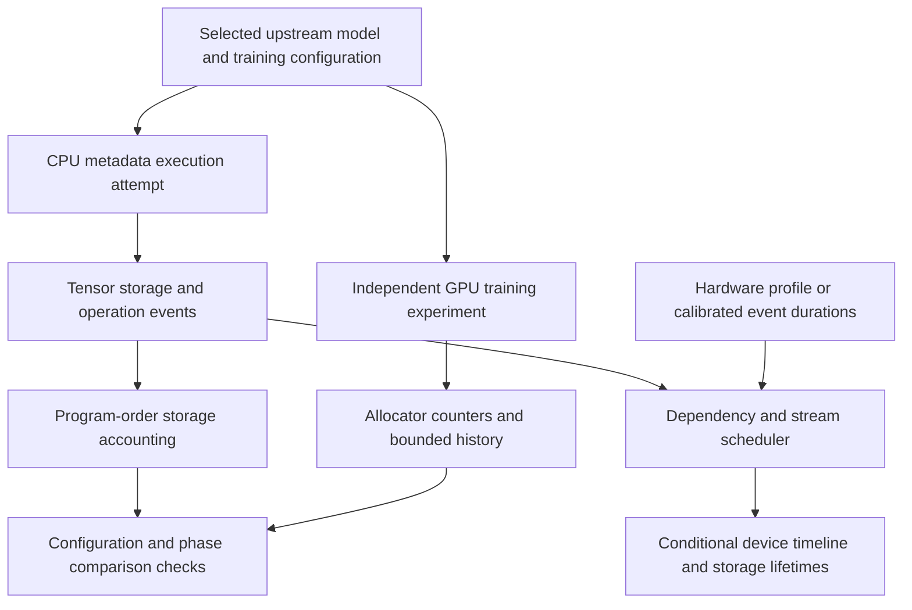

# Analysis of the Titan-Sim Implementation

*Implementation assessment, 14 October 2026. Units are decimal GB and TB unless GiB is explicitly stated.*

## Abstract

Titan-Sim implements the foundations of a CPU simulator for TorchTitan: it captures tensor metadata, accounts for shared storage, schedules events against hardware or calibrated timing models, and collects independent GPU memory observations. Its strongest current capability is explaining the consequences of a supplied execution trace. It is not yet a complete CPU execution environment for TorchTitan, and it has not produced a validated DeepSeek-V3 memory trajectory or runtime prediction.

The design deliberately reuses upstream model and training code. This reduces the risk of maintaining a second, subtly different implementation of DeepSeek-V3, FSDP, or activation checkpointing. It also exposes a harder problem: avoiding numerical GPU kernels does not remove every dependency on native CUDA services, compiled execution, or tensor values. Those dependencies currently prevent complete metadata execution of the selected training configuration.

The implementation distinguishes quantities that are often conflated: tensor storage versus allocator memory, theoretical throughput versus achieved throughput, and simulated synchronization versus a live CPU waiting for fake GPU work. These distinctions make partial results interpretable. They also identify the remaining work needed to meet the original objective.

## 1. Model and System Configuration

The target is the original upstream 671B configuration with the requested parallelism and full activation checkpointing. The validation harness substitutes synthetic fixed-length documents for dataset loading and tokenizer setup. It does not substitute a smaller model for the full target.

| Configuration item | Selected setting |
|---|---|
| Model | Upstream DeepSeek-V3 671B; CPU construction counted **671,026,404,352 parameter elements** |
| System | 256 NVIDIA GB200 GPUs, arranged as 64 nodes with four GPUs per node |
| Pipeline and tensor parallelism | PP=1 and TP=1 |
| Expert parallelism | EP=64 |
| Dense parameter sharding | Automatic FSDP resolves to 256 ranks |
| Expert parameter sharding | Four FSDP ranks within the expert layout; EP64 × expert FSDP4 uses the same 256 GPUs |
| Input data parallelism | 256 ranks |
| Context and input size | 16,384 tokens per document; 65,536 tokens per microbatch per input data-parallel rank |
| Step input volume | With one microbatch per optimizer step, 65,536 × 256 = **16,777,216 tokens globally** |
| Precision | FP32 master parameters and gradient reduction; BF16 compute parameters |
| Optimizer | Upstream AdamW configuration |
| Activation checkpointing | Upstream full activation checkpointing, retaining its RNG and registered-effect handling |
| Attention and compilation | FlexAttention and the upstream local compilation policy retained; CUDA graphs disabled |
| Validation input | Synthetic fixed-length documents and random initialization; no pretrained checkpoint is loaded |
| GPU experiment length | Ten optimizer steps, covering state initialization and subsequent iterations |
| NVIDIA environment | Public PyTorch 26.09 image; exact runtime versions recorded in the provenance appendix |
| Observed device capacity | 197,897,617,408 bytes, or **197.9 GB / 184.3 GiB per GPU**, from the earlier hardware preflight |

The two sharding descriptions matter. Dense FSDP and expert parallelism are not independent factors that multiply the GPU count beyond 256. Dense tensors use the 256-rank sharding layout; routed expert tensors use the combined expert and expert-FSDP layout. A memory calculation that divides every tensor by both 256 and 64 would substantially undercount storage. The shared configuration builder checks the resolved upstream topology. [Configuration evidence](../profiles/deepseek-v3-256gb200.json)

## 2. Architecture and Execution Method

There are three distinct parts: execution capture, event simulation, and independent GPU observation. Their separation allows a timing model to change without rewriting tensor accounting, and allows actual measurements to challenge a projection without becoming its input allocations.

The diagram shows the intended flow; it does not assert that the full-model capture or GPU experiment has completed. The CPU path uses metadata tensors: shapes, strides, precision, device identity, and storage relationships are represented without allocating the numerical model contents. An observer records operations and storage changes as upstream code executes.

This is more faithful than estimating every layer from a separate spreadsheet, but only for the code paths that metadata execution can traverse. A trace must include the actual forward pass, backward pass, optimizer state creation, checkpoint recomputation, and distributed transformations before it can represent a complete training step. Constructing the model is only the first of those requirements.

The event engine itself is independent of PyTorch and can process supplied traces today. The upstream integration is more constrained: the production capture adapter currently represents one logical rank, requires PP=1 and one microbatch per optimizer step, and has not completed the selected full training recipe. Supporting events from multiple ranks is not equivalent to having captured every rank's behavior.

## 3. Memory Accounting and Precision

### 3.1 Logical tensor storage

Logical memory is the sum of unique live backing storage associated with the modeled GPU:

$$
M_{\mathrm{logical}}(k)=\sum_{s\in\mathcal{L}(k)}\mathrm{bytes}(s),
$$

where $k$ is an event position and $\mathcal{L}(k)$ is the set of live storage objects at that position. The horizontal coordinate is program order, not GPU elapsed time.

Counting backing storage prevents views from being counted as separate allocations. A large tensor and several slices can share one storage object. The observer also tracks saved tensors needed by backward and changes to storage size, including FSDP's direct release of backing storage. Storage expiration is detected at operator boundaries, so the release position has that granularity.

For a complete, supported trace, this can account precisely for the storage sizes that were actually represented. It cannot establish that all device allocations were represented. Compiler workspaces, communication-library allocations, and other native allocations may not appear as tensor dispatch events.

### 3.2 Storage retained by asynchronous work

A Python reference can disappear while a previously submitted GPU operation still uses its storage. The scheduled memory model therefore retains storage until both reference release and the completion of all recorded uses:

$$
t_{\mathrm{reclaim},s}=\max\left(t_{\mathrm{release},s},\max_{i\in\mathrm{uses}(s)}t_{\mathrm{finish},i}\right).
$$

A storage object with remaining references stays live. Allocations precede releases at equal simulated timestamps, producing a conservative peak at ties. The model does not reproduce the CUDA allocator's pools, fragmentation, cached blocks, or same-stream reuse of memory before physical completion.

This distinction explains why timing can change memory peaks even when tensor shapes stay fixed. Earlier prefetch or greater overlap can keep more storage live simultaneously. It also explains why a usable time-based memory trajectory needs a host submission schedule. Without explicit host timestamps, allocations can accumulate at the same default time. The implementation retains the program-order trajectory and withholds its supported capacity verdict in that case. Even with timestamps, the verdict describes the supplied scenario rather than proving real GPU feasibility.

### 3.3 What the GPU measurements mean

| Quantity | Meaning | Current treatment |
|---|---|---|
| Logical tensor storage | Unique captured tensor backing storage | Implemented for supported traces |
| Scheduled live storage | Captured storage retained through recorded asynchronous uses | Conditional on dependencies and host timing |
| PyTorch allocated memory | Memory in use according to the CUDA allocator | Independently observed on GPU |
| PyTorch reserved memory | Memory held by the allocator, including reusable blocks | Independently observed; not simulated |
| Total device memory use | Allocator memory plus CUDA, libraries, and other allocations | Not fully captured by allocator counters |

The GPU observer collects layer-boundary samples without synchronizing at every hook, and synchronizes at step boundaries. This reduces disturbance relative to synchronizing every layer, but module samples are host observations rather than exact GPU execution boundaries. Per-step allocator peak counters and selected allocator history provide complementary evidence. Instrumentation can still affect execution.

The reported simulator peak is the largest per-rank peak, not memory summed across the cluster. For feasibility, the relevant question is whether any individual GPU exceeds its available capacity.

### 3.4 An illustrative state-storage calculation

The parameter count permits a useful scale check before a full trace exists. Assume, solely for this calculation, perfectly even partitioning of all parameters across 256 GPUs, with FP32 master parameters and two FP32 Adam moment tensors:

$$
M_{\mathrm{parameters+moments}}=\frac{671{,}026{,}404{,}352\times(4+4+4)}{256}
=31.5\ \mathrm{GB/GPU}.
$$

| Assumed tensor category | Bytes per global parameter before partitioning | Evenly partitioned storage per GPU |
|---|---:|---:|
| FP32 master parameters | 4 | 10.5 GB |
| Two FP32 Adam moments | 8 | 21.0 GB |
| Parameters plus moments | 12 | **31.5 GB** |
| FP32 gradients, if all are simultaneously retained | Additional 4 | Additional 10.5 GB |
| Parameters, moments, and those gradients | 16 | **41.9 GB** |

Totals use unrounded values, so displayed components may differ by 0.1 GB when added. These are hand-derived reference values, not simulator outputs, lower-bound guarantees, or peak-memory predictions. They omit actual rank placement, replicated or padded tensors, compute copies, gathered parameters, activations, routing buffers, workspaces, and allocator reserve. In particular, the model has not established that all listed gradients coexist. The calculation illustrates why parameter count alone cannot determine whether the target fits.

## 4. Hardware Roofline and Calibrated Timing

For an operation with $F$ floating-point operations and $Q$ transferred bytes, arithmetic intensity is $I=F/Q$. The configured compute roofline is

$$
P_{\mathrm{ceiling}}(I)=\min(P_{\mathrm{peak}},B_{\mathrm{HBM}}I),
\qquad
t_{\mathrm{analytical}}=\max\left(\frac{F}{P_{\mathrm{peak}}},\frac{Q}{B_{\mathrm{HBM}}}\right).
$$

The hardware profile must identify the specific GPU, arithmetic mode, dense or sparse convention, and per-GPU normalization. A generation name alone is insufficient. The current GB200 profile uses **2.5 PFLOP/s dense BF16** and **8.0 TB/s HBM bandwidth per GPU**. Its BF16 transition between the bandwidth and compute ceilings is therefore **312.5 FLOP/byte**. Sparse marketing rates are not applied to dense work, and FP8 rates require FP8 execution rather than merely FP8 storage. These are configured theoretical rates, not measured sustained performance. [Hardware profile and derivations](../profiles/gb200.json)

For matrix products, the arithmetic convention counts a multiply and an addition as two FLOPs. Captured FLOPs come from available PyTorch operator formulas. Missing formulas remain visible as unknown coverage; zero recorded FLOPs for an unsupported formula does not establish zero arithmetic. Also, the byte model estimates logical tensor access regions, using enclosing regions for strided views. It does not measure HBM transactions or cache reuse. Consequently, the current roofline is an analytical scenario under its work and traffic assumptions, not a demonstrated bound on real end-to-end training time.

Three timing modes are implemented:

| Timing mode | Duration source | Interpretation |
|---|---|---|
| Roofline | Configured peak arithmetic and bandwidth rates | Idealized estimate without kernel efficiency or launch latency |
| Calibrated | Exact matching event measurement | Rejects missing timing for nonzero modeled work |
| Hybrid | Exact measurement when available; roofline otherwise | Reports fallback coverage by event count, FLOPs, and summed event duration |

An event can also supply an explicit duration with provenance; that duration overrides the timing-mode lookup. Metadata operations, CPU/meta-device work, and control events contribute zero modeled device time.

Captured signatures include tensor shapes, strides, layouts, precision, and scalar arguments. For CPU-projection documents, the command-line calibration path also checks the recorded PyTorch, TorchTitan, and hardware context. The lower-level timing and scheduling functions do not independently perform that environment check. This protects against obvious mismatches, but does not certify measurement quality or reproduce a compiler's fused kernel plan. A calibrated eager operation is not automatically a calibration of a fused region containing that operation.

Communication requires separate treatment. The shipped profile does not turn the published NVLink interface rate into effective collective throughput. Analytical collective timing requires an explicit effective bandwidth; host/device copies require their own bandwidth or calibration. Neither link uses HBM bandwidth. Collective algorithms, startup latency, cross-node topology, and contention are not inferred.

The roofline chart distinguishes an estimated ceiling from a point using calibrated duration. A calibrated kernel point still does not establish whole-model FLOPs utilization. Such a claim also requires a defined FLOP numerator, treatment of checkpoint recomputation, complete workload coverage, a matching hardware denominator, and measured step time.

## 5. Runtime Behavior and CPU Waiting

The scheduler represents stream order, explicit dependencies, and host synchronization. Each rank has one serialized compute lane and one serialized communication lane, which can overlap when dependencies permit. A stream wait constrains device execution; a host wait also delays subsequent submissions by that rank. Device, stream, and event synchronization have distinct scopes.

This supports questions such as whether a supplied communication operation delays downstream compute, or whether an asynchronous operation extends a buffer's lifetime. It does not automatically discover collective participation across ranks, network congestion, multiple simultaneous compute kernels, or the resource competition between communication and compute. All cross-rank rendezvous and relevant dependencies must be represented in the supplied events.

CPU arithmetic and control durations are unmodeled. Host launch overhead is absent unless supplied submission timestamps represent it. The resulting virtual runtime is therefore not a complete host-plus-GPU wall-clock prediction.

The normal simulator uses virtual time and does not sleep. A separate playback feature can sleep until host-synchronization completion times from an already simulated timeline. It does not intercept a live TorchTitan execution, run one live host thread per rank, or wait after every fake kernel. It may also finish before trailing asynchronous work if the trace has no final host synchronization.

The requested behavior—run the original host program and block it only when fake GPU work must complete—therefore remains partly implemented. Achieving it requires a live runtime bridge that records submissions, maintains a device completion clock, and blocks only at the appropriate host-visible synchronization. It must preserve native stream/event behavior as well as Python calls. Timing the CPU metadata interpreter itself would measure simulator overhead, not GPU training time.

## 6. Fidelity to TorchTitan and Remaining Execution Barriers

Reusing the upstream configuration and training engine preserves the intended model, loss, optimizer, sharding, checkpoint policy, and local compilation settings at the source level. A shared configuration builder reduces divergence between the CPU attempt and GPU observer. However, preserving configuration does not prove successful execution of those policies.

Four issues currently prevent that stronger claim:

1. **Parameter initialization needs values.** The selected truncated-normal initializer contains rejection sampling whose loop condition reads tensor values. Metadata tensors cannot determine that condition. Strict capture stops. An explicit post-initialization scope omits random sampling inside parameter callbacks while retaining deterministic operations and buffer initialization. Values remain unknown, and initialization timing and startup peak are excluded.
2. **Native autograd still requests CUDA services.** Python stream and device shims do not replace every C++ device guard used while creating or traversing autograd operations. CPU-only probes expose this dependency. A scratch native-guard experiment is not enabled in the package and has no validated stream semantics.
3. **Compilation changes execution and storage.** An isolated local compiled FlexAttention mask probe failed. More generally, a sequence of eager metadata operations does not establish the buffers, fusion, reuse, or scratch space of a compiled GPU region. That requires an explicit compiled-region representation.
4. **MoE routing determines shapes and communication.** Expert token counts depend on values. The optional balanced-routing scenario supplies conditional equal peer splits; it does not predict natural routing or establish all per-expert work sizes. Matched validation needs the same routing conditions, potentially through recorded control values, without copying measured allocations into the projection.

Full activation checkpointing adds another dependency between memory and time: fewer retained intermediates can require additional forward computation and associated temporary storage during backward. Its memory effect must follow actual lifetimes, rather than a fixed percentage reduction. The same applies to FSDP parameter gathering and prefetch. Their impact depends on when buffers are created, reused, and released relative to other work.

Metadata capture also has its own scalability cost. Recording each operation and its metadata avoids numerical model storage, but the event log and dependency graph still grow with workload size. Full model construction does not establish that a complete training trace is fast or small enough on the CPU host; that has not yet been benchmarked.

## 7. Validation Evidence and Current Results

| Evidence | What it establishes | What it does not establish |
|---|---|---|
| 96 local tests passed, including upstream configuration and installer regression checks | Tested storage, dependency, timing, comparison, and selected configuration behavior on local PyTorch 2.14.1 | Compatibility or accuracy in the NVIDIA runtime |
| Full CPU construction: 671,026,404,352 parameter elements and 235 buffers | Full model shapes and buffer setup under the explicit post-initialization scope | Sharded forward/backward, optimizer execution, or a memory trajectory |
| Earlier four-GPU hardware/NCCL preflight | Device identity, runtime versions, capacity, and one-node collective availability | Training performance or 256-rank communication behavior |
| Synthetic JSON/CSV/SVG comparison export | Report generation works on controlled inputs | A DeepSeek-V3 prediction or measured accuracy |
| Latest reduced validation attempt | Environment setup ran and produced a concrete dependency-resolution failure | Unit tests, FullAC validation, or GPU training in that attempt |
| Dependent full validation | The success dependency prevented execution after the reduced job failed | Any full-model GPU measurement |

The latest setup failure occurred before training: the package install constraint used PyTorch's runtime version string, while the cached NVIDIA wheel advertises a different package-metadata version. The package resolver could not satisfy that constraint when installing an upstream attention dependency. This is an environment setup failure, not evidence that the selected model ran out of memory. The implemented fix constrains the installed package identity while checking the runtime identity separately. Its regression test passes locally; target execution must still be validated.

The successful construction probe omitted **722 random sampling calls inside 603 parameter initializer callbacks**, while retaining the callbacks’ other operations. This exclusion is recorded in its evidence. The current comparison tool rejects that scope for full-document accuracy comparisons, even if the remaining metadata matches. A separate steady-state comparison contract would be needed to compare only a legitimately completed post-initialization interval. [Construction evidence and limitations](validation/CPU_COMPONENT_PROBES.md)

Comparison also requires matching software, dimensions, rank, and execution-policy fingerprints, including routing. Boundaries must match by name and identity or by explicitly reviewed event/sample correspondence. The tool does not align unrelated CPU event indices and GPU timestamps by interpolation. It reports logical-storage versus allocator differences as different metrics, rather than labeling them prediction error. No matched full-model comparison is available yet.

## 8. Assessment and Next Validation

The architecture is suitable for progressively improving a trace-based simulator because storage, timing, scheduling, and observation have separate responsibilities. It can already answer conditional questions about supplied events. Its principal limitation is obtaining a complete and faithful event stream from the original training program, including native and compiled behavior.

The next implementation priorities follow from that limitation:

| Priority | Required work | Evidence of completion |
|---|---|---|
| Restore target validation | Correct environment setup and repeat reduced GPU checks before the full run | Completed setup, FullAC test, and ten-step reduced experiments |
| Complete CPU execution | Resolve native runtime controls and compiled-region handling | Supported forward/backward and optimizer execution with GPUs unavailable |
| Establish routing and rank coverage | Implement explicit routing replay or qualified scenarios and capture relevant ranks | Matching workload controls and rank-specific storage/communication traces |
| Connect live host execution | Implement synchronization-aware waiting against simulated device time | Original host control flow waits at the correct boundaries without running GPU kernels |
| Extend memory fidelity | Model allocator behavior, workspace lifetimes, and external allocations where required | Separately reconciled logical, allocated, reserved, and device-level memory |
| Validate timing | Collect matched kernel and collective calibrations and test held-out cases | Coverage and error reported for defined workloads and configurations |
| Complete the requested comparison | Run the selected full model and compare independently generated, matched phases | Per-rank trajectories, first-step and later-step peaks, and explicitly defined error metrics |

Hardware peak specifications are sufficient to draw a configured roofline. They are insufficient to establish achieved utilization. Tensor metadata is sufficient to account for represented storage. It is insufficient to establish exact GPU memory use. Closing those two gaps requires the complete execution model and independent observations described above. The existing implementation makes the gaps visible rather than filling them with unvalidated constants.

## Appendix: Provenance and Implementation References

This assessment is based on simulator commit `b5dbc989f964a96ffd22b260a242350e7d1fc1d5`, with the validation-job status checked on 14 October 2026. The environment setup correction in commit `76b91ed` was added during report preparation. The 96-test local result includes that correction; the assessed baseline previously passed 95 tests.

| Provenance item | Recorded identity |
|---|---|
| Selected TorchTitan revision | `607852350b41b4b280d8b8de6340f4847ed71c5e` |
| Public container | `nvcr.io/nvidia/pytorch:26.09-py3`, newest monthly public tag found during registry resolution |
| Runtime PyTorch version | `2.14.0a0+b2c75dd062.nv26.09` |
| Installed NVIDIA wheel metadata version | `2.14.0a0+b2c75dd062.nv26.9.68203377` |
| CUDA / NCCL | 13.4 / 2.31.2 |
| Local verification environment | macOS ARM64, PyTorch 2.14.1 |
| Image identity qualification | Runtime/build identity checked; cached squashfs byte-for-byte OCI provenance not independently verified |

The [version manifest](../profiles/versions.json) records expected image digests. The following sources support the implementation analysis without requiring a reader to know the codebase:

- [Selected recipe integration](../titan_sim/recipes.py) and [production capture attempt](../titan_sim/project_engine.py).
- [Tensor and storage observation](../titan_sim/capture.py), [event scheduler](../titan_sim/runtime.py), and [timing models](../titan_sim/costs.py).
- [Roofline rendering](../titan_sim/roofline.py) and [host synchronization playback](../titan_sim/pacing.py).
- [Independent GPU observer](../titan_sim/gpu_compare.py), [comparison rules](../titan_sim/compare.py), and [execution-policy provenance](../titan_sim/provenance.py).
- [Validation record](VALIDATION.md), [multi-node experiment methodology](MULTINODE_VALIDATION.md), and [independent implementation work items](IMPLEMENTATION_ITEMS.md).
