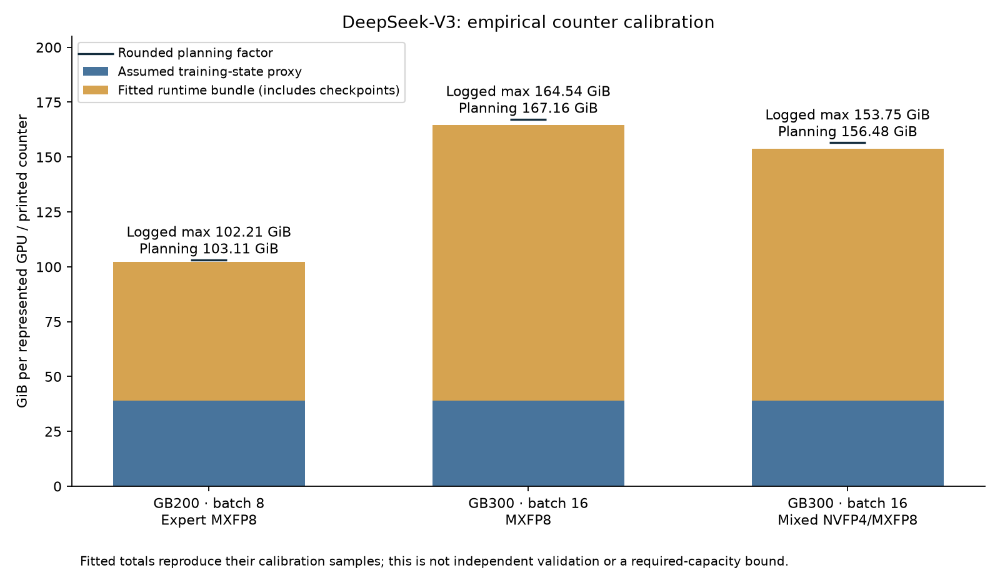

# Memory estimation from GPU runtime logs

**Subsequent validation:** the [expanded-log evaluation](EXPANDED_LOG_VALIDATION.md)
finds that these frozen factors underestimate batch-1 memory by 18–20%. The
rounded planning factors also underestimate batches below 16. The calibration
results below remain valid descriptions of their original fit, not guarantees
of extrapolation accuracy or required capacity.

## Abstract

Titan-Sim now has an empirical memory-estimation path that runs entirely on CPU. It combines a declared training-state baseline with a runtime allowance calibrated from the supplied GPU logs. The existing independent tensor/component simulation remains separate. This allows useful estimates before every internal allocation is understood, while preserving which numbers came from GPU measurements.

For the supplied DeepSeek-V3 PP1/TP1/EP64 FullAC runs, the fitted runtime coefficient is 2.366 for GB200 batch 8, 2.351 for GB300 batch 16 MXFP8, and 2.149 for GB300 batch 16 mixed NVFP4/MXFP8. Rounding those coefficients upward gives provisional planning estimates of **103.11, 167.16, and 156.48 GiB**, respectively. The coefficients multiply a checkpoint-storage proxy, not total model memory. They estimate the logs' printed training-memory counter; its precise allocator API/reset semantics remain unverified.

The logs also support direct reconstruction of stash payloads and dimensionless V4 allocator ratios. They do not support assigning independently measured multipliers to every memory category. Consequently, unresolved V3 consumers share one fitted allowance. No new GPU training was needed for this work, and reproducing the calibration samples is not independent CPU/GPU validation.

## Configuration and source verification

All three V3 calibration runs have 671,026,404,352 model parameters, 256 GPUs, PP1/TP1/EP64, sequence length 4,096, and full activation checkpointing. Their other differences matter:

| Calibration | Hardware | Local batch | Compute conversion | Software and retained evidence |
|---|---|---:|---|---|
| Expert MXFP8 | GB200 | 8 | Expert-only MXFP8 | TorchTitan 0.2.0; compiled blocks; SDPA; unranked repeated counters; training completion logged |
| MXFP8 | GB300 | 16 | Linear and expert MXFP8 | TorchTitan 0.2.2+gita615ec2; compiled blocks and loss; rank-0 counters; training completion logged |
| Mixed NVFP4/MXFP8 | GB300 | 16 | NVFP4 experts and mixed linear conversions | Same logged package suffix; counters retained through step 40; no workload completion marker |

The [configuration audit](validation/runtime_logs/run_audit.json) contains field-specific source lines. All eight reviewed source files were checked against their recorded SHA-256 hashes, including the additional `deepseek_v3_671b.out`; see [verification results](validation/memory_factors/raw_source_verification.json). Calibration binds the parsed observations to those audited identities. The builder does not infer precision or hardware from filenames. Raw logs remain outside the repository.

## Memory consumers and how to account for them

| Category | What consumes memory | What the supplied logs verify | Treatment in the estimator |
|---|---|---|---|
| Parameters, optimizer states, gradients | Parameter shards, Adam moments, gradient storage; potentially master copies or remainders | V3 total parameter count and mesh; Megatron gradient dtypes and bucket geometry. TorchTitan state dtypes are not fully established. | V3 baseline assumes **16 bytes per evenly sharded parameter**: 4 parameter + 4 gradient + 8 Adam moments. This is an explicit assumption, not a measured state factor. |
| Saved and recomputed activations | Checkpoint inputs, temporary recomputation, attention and expert intermediates | FullAC in V3; selective recomputation/offload in Megatron | Normalize the V3 runtime allowance by one BF16 hidden-state boundary per layer. Do not call the fitted allowance an isolated activation measurement. |
| Distributed communication and materialization | FSDP all-gathers, prefetch, MoE dispatch/combine, pipeline send/receive buffers | Mesh and HybridEP buffer configuration; pipeline/gradient reuse configuration in Megatron | Unresolved V3 storage belongs to the combined allowance. PP4 requires its own profile; its microbatch count is not a simultaneous-memory multiplier. |
| Quantized copies, scales, and stash | Packed values, alternate layouts, scales, conversion scratch, paged stash | Explicit stash shapes/dtypes: **23,924,736,000 GPU bytes** in Megatron V3 and **51,219,582,208 GPU bytes** in V4 | **1.0 × recorded padded payload** for a declared component scenario. Keep lifetimes/rank ownership conditional. Never add this again to an empirically fitted total. |
| Kernel/compiler/graph storage | Fused-kernel scratch, library workspaces, graph pools and persistent graph buffers | Compilation/graph policies, but no separate byte census | Absorbed only to the extent covered by the fitted counter/window; no independent category factor. V4 allocator samples precede graph capture. |
| Allocator reservation | Cached blocks, allocation rounding, stream-delayed reuse and fragmentation | V4 allocated/reserved counters at the same sampled points | Use same-row reservation ratios when estimating that allocator scenario. Reserved already includes allocated; unused reservation is not synonymous with fragmentation. |
| External GPU and host memory | CUDA context, NCCL/native allocations outside the tracked allocator, CPU offload buffers | V3 host stash **15,949,824,000 bytes**; external GPU totals absent | Host bytes stay separate. External GPU allowance remains unknown, not zero. No supported universal multiplier. |

For the pipelined V3 run, the audited padded gradient census gives approximately 15.13–15.32 decimal GB across the four represented stages at **2 bytes per BF16 element**. V4 has FP32 gradient exceptions requiring **4 bytes per element**. These are storage-width rules, not fitted overhead factors. Reused gradient/all-gather backing storage is counted once. The [earlier analysis](RUNTIME_MEMORY_ANALYSIS.md) records stage details and attribution limits.

## V3 fitted allowance

The CPU estimator uses

\[
\widehat M = S + \gamma A,
\qquad S=\frac{N}{256}\times16\ \text{bytes},
\qquad A=61\times B\times4096\times7168\times2\ \text{bytes}.
\]

Here, `N` is the logged total parameter count and `B` is local batch size. `S` is an assumed evenly sharded state baseline: **39.0589 GiB**. `A` is a checkpoint normalization proxy: **26.6875 GiB** at batch 8 and **53.375 GiB** at batch 16. The 61-layer, 7,168-hidden BF16 proxy is declared explicitly; it is not a capture of what FullAC actually saves. Dividing by 256 and then again by EP64 would incorrectly shard every parameter twice.

For each calibration run, `gamma = (largest retained training-memory counter − S) / A`. Its runtime allowance **includes A**, other unidentified memory, and any error in the state baseline. Changing the assumed state dtype or lifetime requires recalibration. In particular, `gamma = 2.4` does not mean checkpoint activations themselves consume 2.4 times their theoretical size.

| Run | Largest logged counter | Fitted gamma | Rounded planning gamma | Planning counter estimate |
|---|---:|---:|---:|---:|
| GB200 batch 8, expert MXFP8 | 102.21 GiB | 2.3663 | **2.4** | **103.11 GiB** |
| GB300 batch 16, MXFP8 | 164.54 GiB | 2.3509 | **2.4** | **167.16 GiB** |
| GB300 batch 16, mixed NVFP4/MXFP8 | 153.75 GiB | 2.1488 | **2.2** | **156.48 GiB** |

The rounding policy is `ceil(gamma × 10) / 10`. It is a small planning allowance above each calibration value, not a statistical confidence bound or a guarantee against OOM. Two MXFP8 coefficients being similar is encouraging but does not establish batch scaling: hardware, software, attention and quantized-module coverage differ between those runs. The mixed-precision comparison likewise does not isolate a causal FP4 memory saving.



*The bars contain an assumed baseline and a fitted residual. Their match to the calibration totals is arithmetic, not evidence that individual allocations were independently predicted.*

The implementation also preserves sampled counter histories: for example, GB300 MXFP8 rises from 147.66 GiB at step 1 to 164.54 GiB at retained steps 10–50. Mixed NVFP4/MXFP8 rises from 132.07 to 153.75 GiB. These points cannot reconstruct within-step lifetimes, instantaneous peaks, or a continuous trajectory. No interpolation is used to fabricate allocation events.

## V4: peak and reservation factors

V4's more explicit counters support ratios despite the logger's unknown GB divisor, assuming the counters use a common unit. Ratios are paired within the same source line, rank and iteration. They never borrow a peak from another rank.

| Sample window | Maximum-allocated / current-allocated | Reserved / current-allocated |
|---|---:|---:|
| After iteration 1, four sampled ranks | 1.325–1.528 | 1.406–1.585 |
| After iteration 2, four sampled ranks | 1.224–1.297 | 1.287–1.416 |

For rank 0 after iteration 2, current allocated is **187.98**, maximum allocated **243.74**, and reserved **266.13**, in the logger's printed units. An explicit scenario based on that row uses **1.2966 × current allocated** for the allocated high-water estimate or **1.4157 × current allocated** for the reserved high-water estimate. The latter already includes the former's capacity; multiplying the two factors would double count. A rough conservative envelope over all eight supplied early rows would use 1.585 once, but it is not a bound on the whole run or all 256 ranks.

These ratios explain why a low end-of-iteration allocation does not establish sufficient capacity: a larger transient allocation occurred, and the allocator still holds reusable memory. They do not identify how much of that reservation is fragmentation. Their peak reset window is unknown, and graph capture occurs later, at iteration 4. NaN gradients begin in iteration 2, so these are resource observations from a numerically unhealthy run. Do not apply these V4/Megatron ratios to the V3/TorchTitan unspecified counter.

The rank-0 allocated increase from iteration 1 to 2 is 51.22 printed GB. Stash payload totals 51.2196 decimal GB and its allocation messages occur between the summaries. This strongly motivates a stash attribution hypothesis, but the divisor, unranked stash ownership, coexistence and other concurrent changes still require confirmation. The estimator records the geometry without claiming the entire delta is proven stash residency.

## Implementation and use

`titan_sim.empirical_memory` fits profiles, projects their counter totals, and computes same-row allocator ratios. `scripts/calibrate_memory_from_logs.py` regenerates the catalog and example requests from the audited observations. Three separate profiles preserve the supplied run configurations and source anchors. The independent component ledger still rejects fitted observations as independent predictions.

From the repository root:

```sh
python scripts/calibrate_memory_from_logs.py --plot

python -m titan_sim.empirical_memory \
  profiles/memory/titan_v3_mxfp8_batch16.json \
  examples/memory/empirical/titan_v3_mxfp8_batch16.json \
  --planning --output report/memory_estimate.json
```

The example returns 167.1589 GiB with `independent_validation: false` and `capacity_verdict: unknown`. `--planning` selects the rounded factor; omitting it selects the exact fitted factor. Changed configuration or baseline fields fail by default. `--allow-extrapolation` permits an explicitly labelled scenario and lists every mismatch. Unknown software revision fields remain visible even for an otherwise matching request.

The original requested BF16, context-16,384 recipe is outside these profiles. Equal tokens per rank do not remove sequence-length and attention differences. Hardware changes also require an explicit extrapolation: tensor payload may stay constant, but kernel workspaces, communication paths and allocator behavior can change. GPU capacity and roofline FLOP rates do not determine an empirical memory multiplier.

The `project_allocator_envelope` API separately applies one V4 row's factors to a declared **current allocated-byte** estimate. It is a conditional scenario whose caller must justify workload/rank/window compatibility. It is not automatically applied to V3 estimates. The catalog keeps host stash separate and retains unknown external allocation coverage.

## Validation and next measurements

The implementation tests check source-hash binding, unit conversion, configuration mismatch rejection, explicit extrapolation, baseline changes, rank/window pairing, missing counters, non-finite values, host/GPU separation and rejection of stacked allowances. The public command was exercised on the supplied GB300 MXFP8 profile. These checks validate the estimator's arithmetic and provenance rules, not predictive accuracy on an unseen training run.

To replace the combined runtime allowance with identifiable category factors, collect matched per-rank measurements at initialization, forward end, backward/recomputation, optimizer step and graph capture. Each sample should include current/peak allocated, current/peak reserved, the peak reset point, and device-wide used bytes with other processes accounted for. Allocation snapshots and named buffer sizes can then separate communication, quantization and workspaces; a second matched run should be held out for prediction error. Sparse totals alone cannot uniquely fit several independent category coefficients.

Artifacts: [factor catalog](validation/memory_factors/catalog.json), [CLI example result](validation/memory_factors/example_estimate.json), [raw-source verification](validation/memory_factors/raw_source_verification.json), and [configuration audit](validation/runtime_logs/run_audit.json).
