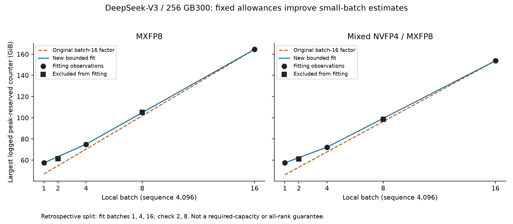

# Diagnosis and correction of the memory-estimation gap

## Abstract

The original V3 estimate underestimates small batches because it assigns all memory above an assumed state baseline to one term proportional to batch size. The logs do not follow that scaling law. Source inspection also resolves an earlier uncertainty: the V3 `memory:` field is **peak allocator reservation**, which includes retained cache as well as live allocations. A live-tensor estimate alone does not predict this counter.

A bounded CPU estimator now fits a fixed allowance and batch-dependent growth in two ranges. On batches 2 and 8 excluded from coefficient fitting, the largest absolute error falls from **12.80% to 2.85%**. These are retrospective checks on previously inspected data, not blind validation. The original worst error, **19.51% at batch 1**, is now a fitting point and cannot be used to claim independent accuracy improvement.

The V4 comparison identifies a different gap: identical reported current and peak allocations coexist with different reservations. The difference belongs to allocator reservation behavior at the counter level; its physical cause is not identifiable from these logs. No universal fragmentation factor is justified.

## Model and system configuration

| Configuration item | Scope of the new V3 estimator |
|---|---|
| Model | Full DeepSeek-V3, 671,026,404,352 parameters |
| Hardware | 256 NVIDIA GB300 GPUs; logs report 276.62 GiB per GPU |
| Parallelism | TP1, PP1, CP1, EP64, FSDP shard degree 256, replication degree 1 |
| Workload | Sequence 4,096; local batch 1–16; one microbatch per optimizer step |
| Memory policy | Full activation checkpointing; compiled transformer blocks and loss |
| Precision | Separate MXFP8 and mixed NVFP4/MXFP8 compute profiles; these are not claims of quantized optimizer state |
| Software identity | Full TorchTitan revision recovered from all ten selected AWS logs; complete PyTorch/DeepEP identity and dirty-tree state remain unverified |
| Target | Largest printed peak-reserved counter in each 50-step run, over observed logger records |
| Fitting / evaluation | AWS batches 1, 4, 16 / AWS batches 2, 8, separately for each precision |

This scope differs from the originally requested GB200 validation and the pinned production-adapter revision. The estimator rejects changed hardware, sequence, precision, revision, compiler policy, or mesh. The Lyris sweep corroborates the same rounded memory maxima, but repeated files and matching results are not evidence of statistically independent experiments.

## Counter definition and observation windows

The expanded AWS logs name TorchTitan revision `a615ec2db9d66d46e9e8d6f679ed73e890369eea` in the `rdspring1/torchtitan` fork. Its package suffix matches the runtime messages. Inspecting that immutable source establishes:

1. The monitor reads `reserved_bytes.all.peak` and converts bytes to GiB.
2. The training logger prints that value as `memory:`.
3. After logging, the monitor resets peak statistics. That reset method does not empty the allocator cache.
4. The initialization message also prints peak reserved memory, rather than parameter payload size.
5. The optimizer step precedes the training metric collection.

Consequently, the step-10 field is a peak over the interval since the preceding metric reset, not an instantaneous live allocation at step 10. Reservation can carry over from previous intervals. The monitor calls `empty_cache()` during initialization, but not in its per-log reset method. We do not assume that no other runtime component ever releases memory.

The relevant source is [the historical metrics implementation](https://github.com/rdspring1/torchtitan/blob/a615ec2db9d66d46e9e8d6f679ed73e890369eea/torchtitan/components/metrics.py#L61) and [the historical trainer](https://github.com/rdspring1/torchtitan/blob/a615ec2db9d66d46e9e8d6f679ed73e890369eea/torchtitan/trainer.py#L491). File hashes and exact line anchors are retained in [the source audit](validation/memory_gap/results.json). This resolves the earlier V3 counter-definition uncertainty for the audited revision; it does not resolve the separate Megatron V4 logger's units or reset policy. Local modifications to the logged revision cannot be ruled out.

## Evidence for the scaling error

All ten selected V3 logs report **13.43 GiB** at model initialization. For both compute formats, step-1 reservation is **42.21 GiB at batch 1** and **42.32 GiB at batch 2**. Doubling the token count barely changes that first-step peak. At larger batches, memory grows much more strongly with tokens.

| Local batch | MXFP8 step 1 | MXFP8 largest logged | Mixed step 1 | Mixed largest logged |
|---:|---:|---:|---:|---:|
| 1 | 42.21 | 57.43 | 42.21 | 57.43 |
| 2 | 42.32 | 61.53 | 42.32 | 61.23 |
| 4 | 55.13 | 74.99 | 51.81 | 72.25 |
| 8 | 83.88 | 105.06 | 78.85 | 98.69 |
| 16 | 147.66 | 164.54 | 132.07 | 153.75 |

All values are GiB from the largest retained records at the stated step/window, not sums across GPUs. Repeated rankless records are not treated as independent rank coverage. Largest values are already present at step 10 and repeat in later logged intervals.

The old equation was `M = S + gamma × A(B)`, where `S = 39.06 GiB` assumes 16 bytes of sharded state per parameter and `A(B) = 3.3359375 × B GiB` is a checkpoint normalization proxy. Fitting only at batch 16 forces every residual byte to scale down with batch. At batch 1, it predicts 46.90 GiB for MXFP8 and 46.23 GiB for mixed compute, versus 57.43 GiB observed. A missing fixed or weakly batch-dependent allowance is therefore a plausible modeling explanation. Changing the assumed state baseline can also change the fitted intercept; the observations do not uniquely determine its physical composition.

The additional memory between step 1 and step 10 is about 15–22 GiB. Two evenly sharded FP32 Adam moment tensors would occupy **19.53 GiB**: `671,026,404,352 / 256 × 8 bytes`. Persistent optimizer state overlapping subsequent forward/backward work is a plausible contributor. It is not proved by the numerical similarity: optimizer state dtype is not established, and [the optimizer wrapper](https://github.com/rdspring1/torchtitan/blob/a615ec2db9d66d46e9e8d6f679ed73e890369eea/torchtitan/components/optimizer.py#L290) can materialize state before training through state-dict operations. Cache growth and changing allocation lifetimes can contribute too.

## Memory categories and attribution limits

| Category consuming memory | Evidence and likely scaling | Treatment now |
|---|---|---|
| Parameter shards, gradients, optimizer moments | Persistent state is largely batch-independent; exact dtype and per-rank ownership determine payload | Keep the explicit 39.06 GiB assumption visible; do not present it as measured state |
| Saved activations and recomputation intermediates | FullAC is logged; growth depends on tokens, layer boundaries, lifetimes, and compilation | Part of fitted batch slope; the checkpoint proxy is not an activation census |
| FSDP materialization, prefetch, gradient reduction | Can overlap persistent state and computation; ownership differs from sharded payload | Unresolved within effective allowance; needs phase/rank measurements |
| Expert dispatch/combine and communication workspaces | HybridEP is initialized with hidden size 7,168 and four local experts; capacity scales with local tokens | No claim of a universal fixed EP buffer: historical source sets capacity from `num_tokens` |
| Quantized payloads, scales, conversions and kernel scratch | Different compute paths have different slopes, but batch-1 counters match | Separate precision profiles; do not multiply all state by the compute bit width |
| Compiler workspaces and graph/private pools when present | Compilation is confirmed; detailed memory plans and V3 graph-pool coverage are not | Absorbed empirically, not assigned a measured component size |
| Allocator cache, padding, split blocks and delayed reuse | Reserved-counter semantics are confirmed; V4 has identical allocation counters but different reservation | Model the logged reservation total directly; do not add another cache multiplier |
| CUDA context and allocations outside PyTorch's allocator | Not measured completely by these counters | Coverage unknown; prevents an OOM-safe required-capacity claim |

The HybridEP capacity behavior is visible in [the historical buffer initialization](https://github.com/rdspring1/torchtitan/blob/a615ec2db9d66d46e9e8d6f679ed73e890369eea/torchtitan/distributed/deepep/hybridep.py#L423). Its existence does not establish how much of its storage is visible in this allocator counter. The rows above are potential owners and overheads, not quantities to sum on top of the fitted total.

## Revised estimator and evaluation

The new equation is `M(B) = S + F_j + slope_j × B`, using continuous affine interpolation between the measured batch anchors 1, 4, and 16. The first range covers batches 1–4; the second covers 4–16. Both have an effective fixed allowance. The ranges are empirical segments, not proven changes in physical execution phase.

| Compute path | Batch range | Effective fixed allowance beyond S (GiB) | Growth (GiB per batch unit) |
|---|---:|---:|---:|
| MXFP8 | 1–4 | 12.518 | 5.853 |
| MXFP8 | 4–16 | 6.081 | 7.4625 |
| Mixed NVFP4/MXFP8 | 1–4 | 13.431 | 4.940 |
| Mixed NVFP4/MXFP8 | 4–16 | 6.024 | 6.792 |

The two intercepts in one profile are alternatives, not additive buffers. Stored coefficients derive from unrounded bytes; displayed values are rounded. The state assumption only decomposes the fitted total: changing that assumed state would shift the effective fixed allowance in the opposite direction.

A single affine line through batches 1 and 16 was also tested. It improves small-batch accuracy but misses batch 4 by up to **6.15%**. The two-range model includes batch 4 as a fitting anchor, so the fair comparison uses only batches 2 and 8 below. The 5% check is an experimental counter-error target, not a capacity safety margin.

| Compute path | Evaluation batch | GPU log (GiB) | Original CPU (GiB) | Revised CPU (GiB) | Original error | Revised error |
|---|---:|---:|---:|---:|---:|---:|
| MXFP8 | 2 | 61.53 | 54.74 | 63.28 | −11.03% | +2.85% |
| MXFP8 | 8 | 105.06 | 101.80 | 104.84 | −3.10% | −0.21% |
| Mixed NVFP4/MXFP8 | 2 | 61.23 | 53.40 | 62.37 | −12.80% | +1.86% |
| Mixed NVFP4/MXFP8 | 8 | 98.69 | 96.40 | 99.42 | −2.32% | +0.74% |



This is an improvement to the CPU **empirical counter estimator**. It does not close the full TorchTitan FakeTensor execution gap, derive each allocation from the model, or produce a newly validated within-step memory trajectory. It uses more fitting observations than the old one-point factor. All sweep values had been inspected before selecting this model, so fresh batch-3/6/12 runs would provide a stronger evaluation.

## V4 reservation variability

For V4 rank 0 after iteration 2, the two configuration-matched logs report:

| Counter | Original ratio source: job 2568526 | Comparison run: job 2565249 |
|---|---:|---:|
| Current allocated | 187.98 | 187.98 |
| Peak allocated | 243.74 | 243.74 |
| Reserved and peak reserved | 266.13 | 252.87 |
| Current reserved minus current allocated | 78.15 | 64.89 |

Units are preserved as the logger's printed “GB”; its divisor remains unverified. The original reservation ratio predicts 266.13 from the comparison run's measured current allocation, overshooting 252.87 by **13.26**, or **5.24%**. The entire difference in these paired counters is reservation, not current or peak allocation. It is not evidence of another 13.26 of live model tensors. Conversely, reserved-minus-allocated is not synonymous with unusable fragmentation: it can include reusable cache and other allocator state.

For this rank/window, observed reservation/current-allocation ratios span **1.345–1.416**. A range of historical scenarios is more honest than selecting either endpoint as a universal factor. That range describes two observations; it is not a confidence interval or an upper bound for future runs. The new audit emits paired differences and observed ratio ranges for every matched rank/window. We leave the original V4 factor frozen rather than tune it to its evaluation run. V3's new batch interpolation is not applied to V4's different PP/offload/graph recipe.

## Validation and reproducibility

The diagnosis script rehashes all ten selected AWS logs, rechecks model/configuration evidence, verifies the full logged revision, and audits the historical source without changing the pinned TorchTitan checkout. Fitting and evaluation source hashes and metric signatures are checked for overlap. Existing one-point profiles remain unchanged. No new GPU training run was launched for this analysis.

```sh
python scripts/diagnose_memory_gap.py /path/to/expanded-archive \
  --torchtitan-root /path/to/torchtitan --plot

python -m titan_sim.memory_regimes \
  profiles/memory/titan_v3_mxfp8_batch_regimes.json \
  examples/memory/mxfp8_batch8_request.json --output estimate.json

python -m unittest discover -s tests
```

The TorchTitan git object database must contain the historical fork revision; the checked-out worktree can remain at the selected production revision. Plotting requires the optional matplotlib dependency. Regression tests use sanitized checked-in evidence and need neither the private raw archive nor GPUs. The CLI reports **104.84 GiB** for the included MXFP8 batch-8 request and leaves required capacity unknown. The full suite ran **252 tests: 243 passed, 9 skipped**; skips do not validate unavailable distributed/native integrations.

For better transferable estimates, the next useful measurements are phase-aligned current allocated, current reserved, peak allocated, peak reserved, allocator backend, and block statistics on identified ranks. Capture before/after forward, backward, and optimizer work on steps 1, 2, and a later steady step, and record explicit reset boundaries. Couple those with unique-storage counts for parameters/gradients/optimizer moments and known EP/quantization buffers. A diagnostic synchronized capture should be labeled separately because synchronization changes overlap. Repeat on matched GB200 and GB300 configurations before fitting hardware-specific residuals. Those measurements can distinguish persistent payload, overlapping temporary allocations, and reusable reservation; the present scalar logs cannot.
