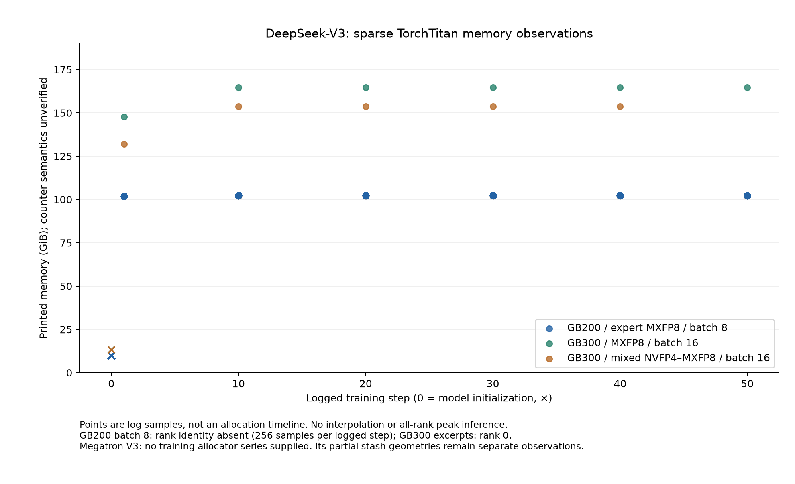
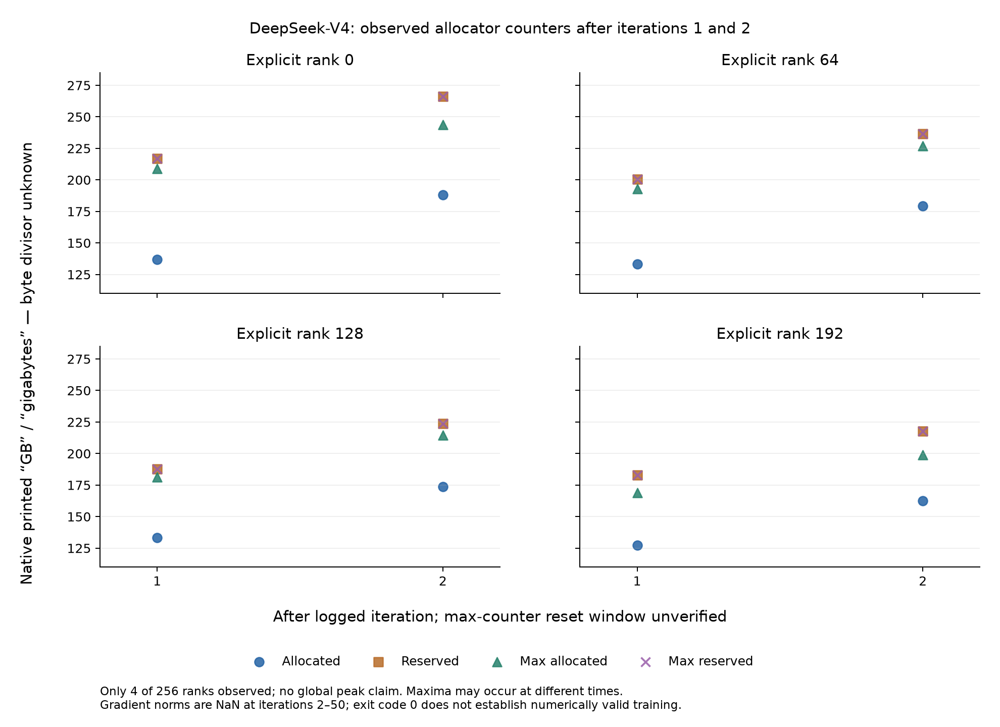
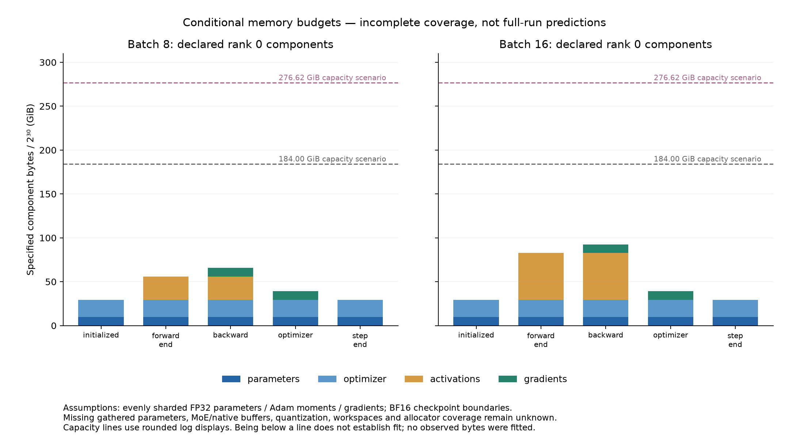

# Runtime Memory Evidence and Conditional Component Budgets

The subsequent [log-calibrated memory model](LOG_CALIBRATED_MEMORY.md) fits
empirical allowances to these observations. The independent conditional budgets
below retain their original assumptions and are not reclassified as calibrated
or validated predictions.

*Assessment of five supplied training runs. GB denotes decimal bytes and GiB denotes binary bytes, except where a logger's unverified `GB` label is explicitly retained.*

## Abstract

The supplied logs identify several substantial memory consumers, but they do not provide a matched CPU/GPU validation of Titan-Sim. Three runs use TorchTitan DeepSeek-V3 with full activation checkpointing; two use Megatron with pipeline parallelism, different precision and recomputation policies, and additional implementation-specific buffers. Combining their memory numbers into one prediction-error table would obscure those differences.

The strongest component evidence comes from explicit buffer shapes and gradient-bucket inventories. The Megatron V3 log describes 23.9 GB of GPU stash buffers and 15.9 GB of host stash buffers. Its listed gradient buckets account for approximately 15.1–15.3 GB on each represented pipeline stage. The V4 log describes 51.2 GB of GPU stash buffers, selective activation offloading, and FP32 gradient exceptions within an otherwise BF16 gradient configuration. These are reconstructions of recorded components, not independently predicted peaks.

The new component-budget path answers a narrower question: how much storage is declared live in each phase, and how does that subtotal compare with an explicitly supplied per-GPU capacity? Two independent, conditional V3 scenarios give approximately 65.7 GiB and 92.4 GiB for their declared simultaneous backward components at local batches 8 and 16. Important categories remain unknown, so neither value establishes total required memory or hardware feasibility.

## 1. Workload and Configuration Audit

Configuration values below come from runtime configuration and execution messages where available. Manifest labels are secondary evidence. All five runs concern 256 GPUs; their model implementations, local work, and memory policies differ.

| Run | Framework and hardware evidence | Parallelism and input | Precision and memory policy | Retained memory and execution evidence |
|---|---|---|---|---|
| V3, GB200, local batch 8 | TorchTitan `0.2.0`; runtime GB200 capacity 184.00 GiB; model count 671,026,404,352 | PP1, TP1, EP64; local batch 8, sequence 4,096 | FullAC; expert-only MXFP8 conversion; SDPA; runtime routing balance enabled | Step counters reach approximately 102.20–102.21 GiB. Training completion is logged. Repeated unlabelled rows do not establish unique rank coverage. |
| V3, GB300, MXFP8 | TorchTitan `0.2.2+gita615ec2`; runtime GB300 capacity 276.62 GiB | PP1, TP1, EP64, dense FSDP256; local batch 16, sequence 4,096, one accumulation step | FullAC; compiled transformer blocks and loss; MXFP8 linear and expert conversions | Logged `memory` rises from 147.66 to 164.54 GiB and repeats at retained steps 10–50. Step 50 and training completion are present. |
| V3, GB300, NVFP4/MXFP8 | Same recorded TorchTitan package suffix and GB300 capacity as the preceding run | Same logged mesh and input dimensions | FullAC; compiled blocks and loss; both NVFP4 and MXFP8 conversions, with dynamic NVFP4 experts | Logged `memory` rises from 132.07 to 153.75 GiB and repeats at retained steps 10–40. A workload completion marker is absent despite wrapper success. |
| V3, GB200, pipelined | Megatron-Bridge/Core and Transformer Engine; direct `nvidia-smi` identifies GB200 despite a contradictory GB300 system manifest | TP2, PP4, VPP4, EP32, CP1; sequence 4,096; microbatch 1; global batch 15,360; 480 microbatches per step | MXFP8, BF16 default gradients and Adam moments; selective MLP recomputation; full-iteration CUDA graphs; MTP and paged stash | Benchmark success and finite loss observations are retained. There are no supplied training allocator counters; explicit stash and gradient-buffer records are available. |
| V4, GB300-labelled, pipelined | Megatron-Bridge/Core; V4 model configuration. Manifest says GB300; profiler identifies the GB11x family, without a supplied direct capacity measurement | TP1/CP1 supported by configuration and accumulation arithmetic; PP4, VPP4, EP64; sequence 4,096; microbatch 1; global batch 4,096; 64 microbatches per step | MXFP8; selective `mla_up_proj`/`mhc` recomputation; attention activation offload; full-iteration CUDA graphs; MTP and forced routing balance | Four ranks have allocator summaries after iterations 1 and 2. Gradient norms are NaN in iterations 2–50, despite a zero NaN-iteration counter and process exit code zero. |

The GB300 TorchTitan runs use fused AdamW, but their logs do not establish the storage dtype of every parameter, gradient, or optimizer state. An NVFP4 or MXFP8 conversion message describes a compute path; it does not mean that all training state occupies four or eight bits per element. Retained loss and gradient values in those two runs are finite, which is useful evidence but not a statement about every unlogged step and rank.

The selected Titan-Sim target uses context 16,384 and 65,536 tokens per input rank. The GB300 logs also have 65,536 tokens per rank, but as 16 documents of length 4,096. Equal token counts do not establish identical attention work, masks, activations, or compiler behavior. The GB200 batch-8 run has 32,768 tokens per rank. Its lower memory counter cannot be attributed to hardware alone.

The pipelined configurations have materially different schedules. Their equivalent layout strings assign 16 decoder blocks to each of PP0, PP1, and PP2, and 13 to PP3. Embedding belongs to PP0; MTP and loss belong to PP3. Four virtual stages and a microbatch group size of four further shape execution. The accumulation counts follow

\[
N_{\mathrm{microbatches}}=\frac{B_{\mathrm{global}}}{D_{\mathrm{input}}B_{\mathrm{micro}}}:
\quad \frac{15{,}360}{32\times1}=480,\qquad
\frac{4{,}096}{64\times1}=64.
\]

These counts are not multipliers for concurrently live activations. That requires the actual pipeline schedule, including forward/backward overlap and delayed weight-gradient computation. The printed dataset field `data_parallel_size=1` must also not be mistaken for the runtime data-parallel mesh.

The [configuration audit](validation/runtime_logs/run_audit.json) retains source identities, qualifications, and line anchors. The [parsed observations](validation/runtime_logs/observations.json) retain individual counters separately from those configuration claims.

## 2. Interpretation of the Observed Memory Counters

The TorchTitan logs print a field named `memory` in GiB. Their retained excerpts do not fully establish whether that field is instantaneous allocated memory, reserved memory, or a peak with a particular reset window. Repeated values therefore describe the printed counter at sampled steps, not a flat allocation trajectory. The additional GB200 log contains 256 unranked rows at logged steps; the row count alone does not prove one distinct observation from every rank.

At retained step 40, the GB300 NVFP4/MXFP8 run reports 153.75 GiB and the MXFP8 run reports 164.54 GiB, a difference of 10.79 GiB, or approximately 6.6% of the latter. This is a comparison of rounded counters under closely related logged configurations. It is not a complete peak-memory comparison or an isolated causal estimate of the effect of compute precision.

*Figure 1. Sparse V3 observations retain their original counter and unit qualifications. Connections between samples must not be read as reconstructed allocation lifetimes.*

The V4 log is more explicit about metric names: allocated, active, reserved, and their maxima. Its eight summaries cover ranks 0, 64, 128, and 192 after iterations 1 and 2. Their peak-reset window is not supplied. Full-iteration CUDA graph capture occurs later, at iteration 4, so these summaries do not establish memory use during subsequent graph execution.

| V4 rank 0 metric | After iteration 1 | After iteration 2 | Unit and interpretation |
|---|---:|---:|---|
| Allocated | 136.76 | 187.98 | Logger-labelled `GB`; conversion divisor unverified |
| Maximum allocated | 208.93 | 243.74 | High-water counter; reset window unverified |
| Reserved | 216.76 | 266.13 | Allocator reservation, including reusable capacity |
| Maximum reserved | 216.76 | 266.13 | A separate high-water counter |

Allocated and reserved memory must not be added: allocated storage is already within the allocator reservation. Similarly, subtracting two independently observed maxima does not recover simultaneous unused capacity, because the maxima need not occur at the same time. Four sampled ranks do not establish the worst rank across 256 GPUs.

*Figure 2. V4 allocator observations cover early iterations and selected ranks. The printed `GB` convention remains distinct from verified decimal GB or binary GiB.*

The V4 NaN gradient norms limit numerical interpretation. The run demonstrates execution and resource consumption under its recorded conditions; it does not establish valid training. The supplied Nsight analysis text reports approximately 20.8 seconds per iteration and 3.82% all-rank idle time, but also reports missing kernel summaries, a failed step-window lookup, and inferred topology. Those downstream summaries provide neither an allocation timeline nor exact kernel calibration. Idle time is not a measurement of achieved FLOP utilization.

## 3. Classification of Named Memory Consumers

A useful memory explanation separates the owners and representations of storage from the framework's aggregate counters.

| Consumer | Evidence or governing quantity | Remaining qualification |
|---|---|---|
| Persistent parameters | Local tensor elements, sharding ownership, and actual storage representation | BF16 configuration can coexist with FP8 representations and master-parameter remainders |
| Optimizer state | Adam moment tensors and any master/remainder storage | Per-parameter dtype, padding, and shard ownership must be established |
| Gradient buffers | Padded bucket elements and explicitly listed gradient dtypes | Some buffers are reused for parameter gathering; adding both roles would double count |
| Gathered parameters | Full or partial parameter materializations during forward/backward | Prefetch, overlapping layers, and reclamation determine the peak |
| Checkpoint boundaries and recomputation | Saved inputs and temporary recomputed tensors | FullAC is a policy, not a fixed percentage memory reduction |
| Pipeline buffers | Stage inputs, outputs, gradients, and active microbatches | Requires stage-specific shapes and the pipeline schedule |
| MoE communication and stash | Dispatch, combine, expert intermediates, and paged-stash buffers | Routing, padding, quantization, and host offload change residency |
| Quantization data | Packed values, scales, orientations, and temporary conversions | Compute precision alone does not specify the bytes |
| Compiler and kernel workspaces | Fused-region temporaries and CUDA graph storage | Generally absent from tensor metadata and sparse log counters |
| External allocations and allocator cache | Native library storage and unused reserved blocks | Neither is recovered by subtracting a simple parameter formula from a peak |

### 3.1 Gradient-buffer reconstruction

The V3 pipeline log lists 58 gradient buckets with padded element counts and BF16 gradient entries. Summing those counts independently reconciles with the printed local parameter-element totals for the four represented stages:

| Represented stage and printed launcher label | Padded gradient elements | Payload at 2 bytes per element |
|---|---:|---:|
| PP0, launcher label 0 | 7,566,393,344 | 15.1 GB |
| PP1, launcher label 64 | 7,637,041,152 | 15.3 GB |
| PP2, launcher label 128 | 7,637,041,152 | 15.3 GB |
| PP3, launcher label 192 | 7,660,498,944 | 15.3 GB |

Stage identities are corroborated by the corresponding tensor/pipeline model-parallel count messages. Launcher labels are retained as printed; they are not, by themselves, proof of global GPU-rank identity. This is a reconstruction of declared bucket payload, not an independently simulated peak. The same configuration enables reuse of gradient buffers for MXFP8 parameter all-gather. A component ledger must count the backing storage once even when its role changes.

V4 requires finer classification. Its default main-gradient dtype is BF16, but actual bucket entries include FP32 gradients for hyperconnection parameters. For example, one printed bucket contains 5,648,896 padded elements and explicitly FP32 gradient entries. Untagged, interleaved output prevents reliable attribution of every bucket to a pipeline rank merely by proximity to a parameter-count message.

### 3.2 Quantized stash buffers and host offload

Five allocation records in each Megatron log provide shapes and storage dtypes. Their byte counts follow directly from shape products and item sizes, including the explicitly stored quantization scales.

| Recorded allocation group | GPU payload | Host payload |
|---|---:|---:|
| V3 paged stash | 23.9 GB | 15.9 GB |
| V4 paged stash | 51.2 GB | Not specified in these records |

The exact GPU sums are **23,924,736,000 bytes** for V3 and **51,219,582,208 bytes** for V4; the V3 host sum is **15,949,824,000 bytes**. These figures identify substantial named consumers. They do not establish complete allocation lifetimes, alias relationships, or simultaneous residency across all ranks. Host storage is reported separately and does not consume GPU capacity.

One numerical correspondence merits investigation. V4 rank 0's printed allocated counter increases by

\[
187.98-136.76=51.22\quad\text{in the logger's printed GB units}.
\]

The five stash allocations total **51.219582208 decimal GB**, which rounds to the same number. This is consistent with the stash accounting for the increase **if** the logger uses decimal GB, the unranked stash messages describe rank 0, and those allocations coexist without offsetting releases or other changes. None of those conditions is fully established by the supplied records. The correspondence is an attribution hypothesis, not a validated decomposition or an independent prediction.

V4 also prints an attention-offload summary for `core_attn` and `attn_proj`, including 71,666.91 logger-labelled MB for rank 0. The implementation defining that summary is absent: accounted or transferred volume cannot automatically be interpreted as simultaneous host residency or GPU memory saved.

### 3.3 Limits of a weight-plus-state formula

Both Megatron configurations enable a precision-aware optimizer and parameter remainders. Their FP32 `main_params_dtype` does not establish a separate four-byte master tensor for every parameter, and BF16 parameter configuration does not establish a separate two-byte copy when FP8 representations are enabled. V4's printed theoretical parameter and memory estimates also differ in definition from its local parameter-count messages.

A conditional two-moment formula is

\[
M_{\mathrm{moments}}=4\left(\frac{N_{\mathrm{dense}}}{D_{\mathrm{dense}}}+\frac{N_{\mathrm{expert}}}{D_{\mathrm{expert}}}\right)\ \mathrm{bytes},
\]

where the element counts are local after tensor/pipeline/expert placement, and the divisors describe optimizer sharding. It assumes two BF16 moments for every element and ideal partitioning. The logs do not establish all those assumptions or the required per-rank census. Consequently, neither the theoretical V4 weight/optimizer estimate nor an aggregate parameter count should be subtracted from an allocator peak to label the residual “activations.”

## 4. Independent Conditional Component Scenarios

The observation parser preserves source lines, rank uncertainty, metric names, and units. It also extracts explicit stash shapes as observed components, preserving launcher labels separately from GPU-rank identity and leaving omitted host sizes unknown. It does not convert observations into predicted allocation events. Separately, the component-budget module accepts declared tensor shapes or byte sizes, storage identities, ranks, provenance, and phase lifetimes. It counts aliases once and keeps CPU buffers separate from GPU buffers. The input contract excludes observed allocations and fitted residuals as independent predictions; provenance labels still require review rather than certifying their own truth.

For a rank \(r\) and declared phase \(p\), the known GPU subtotal is

\[
M_{r,p}=\sum_{s\in\mathcal{L}_{r,p}}\mathrm{bytes}(s).
\]

The relevant known peak is \(\max_{r,p}M_{r,p}\), not a sum of peaks from different ranks or phases. Unknown live components and uncovered categories keep total required memory unknown. Allocator cache, when explicitly modeled, means only unused reserved bytes.

The two accompanying V3 examples assume an evenly sharded representative rank, FP32 master parameters, two FP32 Adam moments, and an already initialized optimizer. They additionally declare FP32 gradients and one BF16 checkpoint boundary per decoder block, with 61 boundaries simultaneously live at the selected backward phase. This is a transparent scenario about lifetimes, not a captured execution of FullAC.

| Declared component | Local batch 8, sequence 4,096 | Local batch 16, sequence 4,096 |
|---|---:|---:|
| FP32 parameters and two FP32 moments, evenly divided over 256 ranks | 29.3 GiB | 29.3 GiB |
| FP32 gradients, assuming all declared gradients coexist | 9.8 GiB | 9.8 GiB |
| 61 BF16 boundaries of shape `[batch, 4096, 7168]` | 26.7 GiB | 53.4 GiB |
| Declared simultaneous backward subtotal | **65.7 GiB** | **92.4 GiB** |

Totals use unrounded values. The parameter assumption starts from 671,026,404,352 elements, or 2,621,196,892 per representative rank. Dense FSDP and expert parallelism are not additional divisors to apply successively to every tensor: expert placement and expert FSDP together distribute the expert tensors across the same 256 GPUs.

These examples leave gathered parameters, extra activations, MoE buffers, quantization storage, workspaces, external allocations, and allocator cache unknown. They are not fitted to the observed 102.2 GiB or GB300 counters. A difference between a scenario subtotal and a logged counter is therefore not an error estimate or a component attribution.

*Figure 3. Independent declared component scenarios. Missing categories remain unknown; a subtotal below a capacity line does not establish that the workload fits.*

The machine-readable [batch-8 budget](validation/runtime_logs/budget-batch8.json) and [batch-16 budget](validation/runtime_logs/budget-batch16.json) preserve the exact values and assumptions.

## 5. Capacity Scenarios Across Hardware

A capacity comparison is meaningful per GPU. For an explicitly supplied capacity \(C\), known headroom is \(C-\max_p M_{r,p}\). If declared known components already exceed capacity, that scenario exceeds capacity. If known components fit but any relevant category remains unknown, the result remains unknown. Even a fully specified ledger establishes only conditional fit under its declarations, not empirical feasibility.

The supplied capacity scenarios use the relevant logs' rounded device capacities: 184.00 GiB for the additional GB200 run and 276.62 GiB for the two GB300 TorchTitan runs. These are not exact byte measurements or specifications for every device bearing the same product name.

Moving an unchanged tensor shape and storage dtype from GB200 to GB300 does not change its logical byte count. The new capacity path therefore applies the same ledger to each capacity profile. A different kernel, workspace, quantization representation, sharding arrangement, or pipeline schedule requires a separate explicit workload specification. It is not valid to scale an observed allocator peak by the ratio of GPU capacities or to use one machine's nominal capacity as another run's measured capacity.

Reuse is equally important. A gradient buffer subsequently used for gathering parameters remains one allocation; allocations that occupy different phases must not be summed into a simultaneous peak. Conversely, asynchronous work can extend a buffer's lifetime beyond its last host reference. The phase-budget path depends on declared lifetimes and does not infer those asynchronous extensions from the supplied training logs.

## 6. Missing Implementation and Missing Evidence

Two different limitations remain. Some require more evidence; others require simulator work.

| Limitation | What is missing | Consequence |
|---|---|---|
| Observation interpretation | Matching logger source, unit divisor, reset boundaries, unique rank identity, and complete sampling windows | The retained counters cannot be treated as aligned per-rank peaks or allocation trajectories |
| State-storage reconstruction | Per-rank parameter/state manifests, actual dtype exceptions, quantization representations, and alias ownership | A complete weight/optimizer/gradient ledger cannot be obtained from headline precision alone |
| Native and compiled CPU capture | A complete supported traversal of upstream forward, backward, optimizer, native controls, and compiled regions | More detailed logs alone will not complete the CPU execution environment |
| Pipeline-parallel execution | An implemented upstream pipeline capture/scheduling path | The budget module accepts explicit pipeline-buffer lifetimes, but does not execute or reconstruct PP4/VPP4 automatically |
| Dynamic lifetimes and allocator fidelity | Validated routing, asynchronous uses, prefetch, native workspaces, and allocator behavior | A component subtotal cannot establish a device-memory peak |
| Independent cross-validation | A separately generated projection with matching framework, revision, workload, policy, metric, rank, and phase | None of the five runs currently provides full CPU/GPU accuracy validation |

The event simulator already accepts multiple ranks and explicit dependencies; that is different from capturing a real multi-rank training schedule. Likewise, adding a `pipeline_buffers` category is useful accounting support, but it does not implement pipeline execution. These distinctions should remain visible when describing the new functionality.

## 7. Validation and Conclusions

The evidence supports three concrete checks: configuration consistency against runtime messages, exact reconstruction of selected buffers from shapes and dtypes, and reconciliation of the V3 gradient-bucket element totals with local parameter counts. The new parser and component-ledger tests check their data-handling contracts; their passing does not validate a full training projection. Current test results are recorded in the repository's [validation record](VALIDATION.md).

A separate target-environment attempt verified the selected NVIDIA runtime and four GB200 devices, then passed the 96 simulator tests present at that point. The subsequent upstream FullAC registered-effects test failed because its callback count was two where one was expected after the first backward pass. Validation stopped before the CPU probes and GPU training checks, and the dependent full run was cancelled. A standalone CPU diagnostic reproduces the checkpoint runtime's effect replay without simulator imports; an explicit-save diagnostic control avoids replay. Both cases produce the expected gradients. This identifies a checkpoint/effect-contract incompatibility, not demonstrated DeepSeek gradient corruption. No upstream policy was changed. The attempt produced neither a target memory measurement nor evidence of an out-of-memory failure; it is separate from the five supplied runs analyzed above.

The most useful next comparison is a phase-aligned, independently generated storage projection for one fully specified workload. It should preserve semantic categories and shared storage, then compare those quantities with the corresponding GPU evidence rather than treating allocator totals as tensor allocations. The supplied logs already explain why MoE stash, gradient buffers, quantization, offload, and scheduling deserve explicit treatment. They do not yet establish that all major consumers have been captured, or that the selected full model fits another hardware configuration.

## Source and Implementation References

The [sanitized run audit](validation/runtime_logs/run_audit.json) is the source index for all five runs. In particular, `slurm-3061209.out` lines 3145–3149 describe the V3 pipeline layout; lines 4016–5764 contain its gradient buckets; lines 8433–8437 describe its GPU and host stash. The V4 training log contains gradient dtype exceptions at lines 25874–25879, the offload summary at lines 63995–64257, stash allocations at lines 64274–64278, and early allocator counters at lines 64265–64290. The additional GB200 source, `deepseek_v3_671b.out`, records capacity at line 28131, model elements at line 34405, FullAC at line 61174, trainer dimensions at line 133127, the first retained step at line 135425, and completion at line 140249. The two short GB300 TorchTitan traces retain conversion, configuration, and sparse step evidence rather than complete per-rank allocation histories.

Implementation references: [observation parsing and eligibility checks](../titan_sim/log_observations.py), [component lifetimes and capacity scenarios](../titan_sim/memory_budget.py), and [broader implementation assessment](IMPLEMENTATION_ANALYSIS.md).
