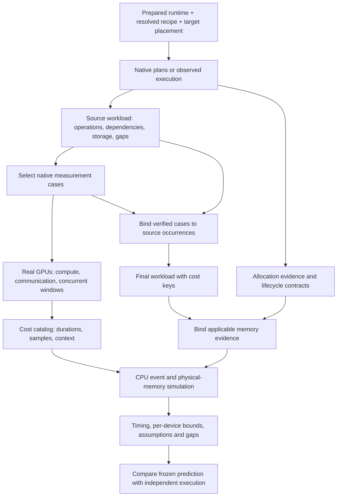

# System design

titan-sim estimates whether a submitted TorchTitan recipe fits each GPU and how
fast its declared training work will complete. The expensive part of answering
those questions is usually running the entire target configuration. The design
instead collects native execution structure, measures representative pieces on
real GPUs, and composes them on CPU. This page explains what each piece contributes;
the [workflow](gpu-assisted.md) explains how to use them.

## Responsibilities and boundaries

There are three owners in a prescreen:

- **The prepared runtime and TorchTitan** own executable training: model code,
  input generation, optimizer, parallelization, compilation and native libraries.
- **The simulation agent or engineer** connects that runtime to the prediction:
  selects evidence, supplies missing integration contracts, launches authorized
  measurements and records uncertainty. The caller provides execution access and
  resource limits. The agent skill does not replace runtime preparation.
- **titan-sim** provides capture, preparation, measurement and binding interfaces,
  plus a CPU event and memory simulator. It validates the supplied contracts;
  it cannot infer every native behavior from a recipe or trace.

The framework-independent simulator never imports the training model. Native
adapters and providers execute in the pinned training environment. This lets
new workloads reuse the same simulation logic without copying model forward
passes or adding model-name branches.

## From a recipe to a prediction

A recipe expresses training choices. A simulator needs a concrete description of
operations, dependencies, placement and live storage. GPU measurements alone do
not supply that description, and an execution graph alone does not supply costs.

These are artifact boundaries, not necessarily separate processes. For example,
retaining a compiled callable and benchmarking it must happen in its owning
process; a JSON file cannot preserve a live executable handle.

## Execution structure: what runs and what waits

The native integration has complementary evidence routes:

| Evidence route | Information it contributes | Boundary |
|---|---|---|
| Host plan export and lowering | Already-constructed schedule actions, stage graphs and supported logical lifetimes | Currently lowers a complete pipeline group; does not construct every graph or infer a global DP/TP/EP mesh |
| Native profiler or dispatch capture | Operations executed by the original trainer, correlations and tensor evidence | Captures require interpretation; missing ranks, waits or opaque internals remain gaps |
| Local CUDA discovery with fake groups | Actual local compute under target logical membership and explicit representative communication outputs | Substituted transport is configuration evidence; it cannot establish real peer completion or numerical training |

The resulting **source workload** contains event nodes, backing-storage records,
a manifest and hardware data. A node identifies an operation occurrence on a
rank, its dependencies and resources. Storage identifies backing allocations and
their users, so aliases can share one allocation. The manifest records scope,
useful tokens, runtime/source identities, placement and unresolved semantics.

Preparation combines evidence across ranks. Supported schedule recovery can
reconcile native functional collective completions and exact wait/storage
lineage from complete peer captures with a shared run identity. A host issue
call and device completion are distinct events. Unknown c10d Work waits, stream
ordering and global layouts still need explicit evidence or integration.

Host schedules therefore contribute ordering constraints, while native
observations fill in runtime behavior. Neither establishes overlap or contention
costs by itself. Instrumentation and representative inputs can also affect
runtime choices; correspondence to original training must remain explicit.

## Calibration: how much the native work costs

A **measurement workload** describes selected cases to benchmark. A native
provider supplies the actual executable and its input, reset and stream-completion
contracts. The measurement runner warms it up and records repeated GPU durations.
This is where execute-mode calibration happens. Trace-import mode instead imports
matched instrumented GPU observations and retains that different evidence level.

Measure local compute on one target GPU where it fits. Measure communication with
its actual implementation, group size and topology. Measure short native windows
when compute and communication influence one another. A window keeps the native
buffers, streams and waits; its cost describes that window and context.

The resulting **local cost catalog** is a JSON mapping from exact cost keys to
durations, samples and provenance. “Local” means files retained with the run;
there is no required database or calibration service. It is not a conversion
from CPU time to GPU time. Analytical costs are a separate, explicitly declared
model when applicable measurements are absent.

The benchmark case and the original training occurrence are different objects.
**Binding** verifies their source snapshot and native descriptors, then assigns
the measured key to the corresponding source occurrence. Relevant context
includes implementation/build, shapes, strides, scalar arguments, precision,
state policy, compilation/graph mode and communication placement. A similar
kernel name or shape is insufficient evidence of equivalence.

Closed native windows bind as one atomic event, preventing double charging of
their internal operations. That conservative representation loses internal
scheduling freedom. Automatic trace-to-window reconstruction and general
interference modeling remain open integration work.

For a custom library, an agent inspects the selected implementation, chooses a
faithful executable boundary and qualifies a provider through the existing
interfaces. Hidden transport may require distributed measurement; opaque state
may require a larger lifecycle boundary. See the
[custom-library workflow](custom-library-workflow.md). A new library does not
need a separate simulator architecture.

## Memory: which allocations coexist on each GPU

Physical memory is modeled independently of timing calibration. The target
schedule determines when declared allocations coexist. Placement combines live
allocations from any ranks sharing a device; alias identity prevents double
counting. The assessment must also cover persistent model/gradient/optimizer
state, activations, gathered parameters, workspaces, communication buffers,
graph pools, allocator slack and external allocations.

Native allocator histories and state inventories help establish sizes, ownership
and lifetimes. A free request can precede actual release. Expandable virtual
reservations differ from physically mapped memory. Observed peaks and conditional
replay envelopes are useful evidence, but do not prove an upper bound for another
configuration. Allocated bytes are already contained in reserved bytes.

An applicable memory bundle binds to the final workload after timing-region
contractions. It declares the covered devices, categories and lifecycle phases.
Full-recipe fit includes initialization and checkpoint loading as well as the
simulated schedule. Missing coverage leaves the upper bound unknown.

The memory result is `estimated_fit` when supported upper bounds fit every device
budget, `estimated_not_fit` when a credible lower bound exceeds a budget, and
`inconclusive` when the evidence cannot decide. Conditional forecasts remain
separate. Budget overflow and exceeding physical capacity are also distinct.
See [physical-memory semantics](native-memory.md) and
[evidence binding](memory-evidence.md).

## Simulation and validation

The CPU simulator schedules events according to dependencies, communication
rendezvous and declared exclusive resources, using matching measured costs or
explicit analytical costs. It calculates completion time, useful-token throughput
and allocation lifetimes. Missing required costs are errors, not zero-duration work.
Hardware specifications alone cannot price opaque operations.

This model does not automatically infer bandwidth sharing, compiler overlap,
dynamic routing or external contention. Those require applicable measurements,
explicit modeling or unresolved limitations. Strict timing coverage and physical
memory sufficiency are separate checks, as explained in
[reading a result](../README.md#read-the-result).

Finally, a frozen prediction can be compared with a separate native control over
the same recipe/runtime/placement and timing/memory scope. A caller-provided
control runner owns that execution. Replaying calibration samples is not
independent validation. Component qualification cannot establish full-training
accuracy; [prediction validation](prediction-validation.md) preserves that boundary.

For command signatures, Python contracts and the source-module map, use the
[integration reference](reference.md).
