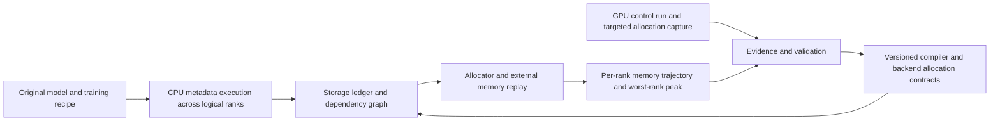

# Per-model GPU allocation coverage implementation plan

**Goal:** predict the bytes, lifetime and dependencies of every material GPU allocation for a specified model, recipe, implementation and hardware profile, then compare the resulting per-rank trajectory with matched GPU measurements. Unknown allocations must remain explicit. Completion is version- and configuration-specific; it is not a claim to emulate every CUDA backend.

**Architecture:** the simulator runs the original supported training path with CPU metadata tensors. A storage ledger records visible tensor allocations and aliases. Implementation contracts and captured GPU/compiler evidence supply allocations that are invisible to tensor dispatch. A dependency graph determines when buffers can be reused or freed. Allocator replay produces allocated/reserved trajectories; external allocations are tracked separately. GPU experiments validate this system and populate contracts; GPUs are not required for a previously supported CPU prediction.

**Tech stack:** existing TitanSim Python event/runtime modules, PyTorch metadata dispatch and AOT capture, TorchTitan, compiler manifests, backend allocation probes, versioned JSON evidence, unittest. Megatron-Bridge/Transformer Engine evidence remains a distinct adapter and calibration namespace.

**Execution:** each work package below is suitable for an independent implementation subagent once its dependencies are complete. Workers should use the executing-plans skill and land a focused commit with its evidence and tests. This document plans future implementation; the accompanying report only recomputes existing evidence.

## Baseline and scope

The pinned TorchTitan revision is `607852350b41b4b280d8b8de6340f4847ed71c5e`. Current local CPU probes use PyTorch 2.14.1. The available public NGC 26.09 runtime is `2.14.0a0+b2c75dd062.nv26.09`, CUDA 13.4, NCCL 2.31.2. These are different execution environments; passing locally is not a container validation.

The unsharded DeepSeek V3 671B CPU probe completes a short, 16-token original forward/recompute/backward/AdamW path. Reduced TrainingEngine probes complete degree 1 and logical rank 0 of FSDP2/EP1. EP2 still encounters data-dependent routing at `input_splits.tolist()`. Existing pipeline and collective simulation does not automatically capture every original-model rank.

Historical V3 671B and 16B memory profiles use different TorchTitan revisions. The V4 and GPT-OSS evidence uses Megatron-Bridge/Transformer Engine. Preserve these identities; do not silently treat them as validation of the new TorchTitan revision. TrainingEngine is TorchTitan orchestration, not Transformer Engine.

The first production target remains DeepSeek V3 671B, 256 GB200, PP1/TP1/EP64, FSDP auto, full activation checkpointing. Resolve and record the actual FSDP mesh rather than treating “auto” as a numeric degree. Add PP4/TP2/EP32 and other recipes only with their own configuration and backend evidence. V4 requires its actual implementation; Nemotron approximately 2.3T requires a verified architecture before a numerical prediction.

## Data flow

## Accounting rules and shared interfaces

An allocation record must contain `allocation_id`, `storage_id`, owner, category, rank/device, requested bytes, rounded bytes, allocator/pool, stream, creation event, final-use events, release event, alias/parent relation and evidence identity. Unknown sizes or releases are explicit unknowns. Address reuse creates a new allocation generation. Aliases share one backing-storage charge.

A dependency edge records its type: program order, producer/consumer, stream event, collective completion, pipeline send/receive, graph replay or allocator reuse. A Python reference disappearing is not proof that an asynchronous GPU allocation is reusable. CPU wall-clock time is not a GPU lifetime clock.

Use four separate outputs: current allocated, peak allocated, current/peak reserved, and device-wide used memory. A typical device accounting equation is `PyTorch reserved + external device allocations + context/driver usage`, with shared pools deduplicated. Never add PyTorch allocated to reserved, or sum unrelated category peaks. Required capacity is the largest simultaneous device footprint plus declared uncertainty/headroom, subject to allocation feasibility; it is not automatically the observed peak-reserved counter.

Every result carries model/configuration, source and container digests, software versions, GPU SKU/topology, rank set, phase/window/reset semantics, unit divisor, capture mode and coverage status. Every contract declares its supported shapes and mesh domain. Out-of-domain use fails or returns an explicitly incomplete result.

## Work packages

### 1. Evidence and metric normalization

**Owner:** evidence worker. **Dependencies:** none.

Files: extend `titan_sim/provenance.py` and `memory_validation.py`; add `titan_sim/allocation_contracts.py`, `tests/test_allocation_contracts.py` and `schemas/allocation-contract-v1.json`.

- [ ] Implement the shared allocation/dependency contract and strict configuration fingerprint.
- [ ] Distinguish implementation-derived, measured ownership, stack-hint attribution, calibrated residual and unknown evidence. A stack mentioning GEMM is not verified ownership by itself.
- [ ] Import existing manifests, counter definitions and source hashes. Retain raw printed units when the divisor is unverified; reject byte conversion and capacity verdicts in that state.
- [ ] Record allocator reset points and logging cadence. Deduplicate mirrored/rounded runs and distinguish calibration anchors from evaluation observations.
- [ ] Test ambiguous units, missing ranks, changed revisions, duplicate allocation generations and mismatched windows. Run `python -m unittest discover -s tests -p 'test_allocation_contracts.py'`.

**Exit:** each comparison identifies exactly which counter, rank and interval it predicts; existing archive hashes and metric source evidence are reproducible. Unknown V4 divisor/reset definitions remain visible until verified in the logging implementation.

### 2. Complete original-model CPU execution and distributed dependencies

**Owner:** distributed capture worker. **Dependencies:** 1.

Files: `titan_sim/capture.py`, `cpu_metadata.py`, `distributed.py`, `pipeline.py`, `fake_device.py`; `scripts/probe_cpu_training_engine.py`; add `tests/test_model_distributed_capture.py`.

- [ ] Resolve data-dependent MoE routing using captured per-rank routing counts or an explicitly declared scenario. Carry counts through dispatch/combine and backward. Do not substitute fabricated uniform routing and call it production capture.
- [ ] Execute all logical rank classes, including PP first/middle/last stages, expert owners and uneven partitions. Collapse ranks only after proving equivalent storage/dependency behavior.
- [ ] Capture FSDP all-gather/reduce-scatter, resharding, prefetch, retained gradients, gradient accumulation and optimizer lazy initialization from the original execution path.
- [ ] Integrate actual pipeline microbatch ordering, sends/receives, activation retention and recomputation. Include one full optimizer step plus subsequent steps that reveal caches and cleanup.
- [ ] Link collective completion and stream waits to storage reuse. Add tests where early release underestimates a peak, and where rank 0 is not the worst rank.
- [ ] Run `python -m unittest discover -s tests -p 'test_model_distributed_capture.py'`; run the existing strict CPU probe first at reduced EP2, then scale shapes and mesh without allocating real model tensors.

**Exit:** supported recipe finishes forward, recompute, backward, communication and optimizer on every required rank; unsupported operators/data dependencies fail with a named coverage gap. CPU capture still does not claim hidden workspace discovery.

### 3. Compiler buffers, fusion and reuse

**Owner:** compiler worker. **Dependencies:** 1; integrate after 2.

Files: `titan_sim/compile_capture.py`, `compiled.py`, `inductor.py`, `checkpoint.py`; add `tests/test_compiler_allocation_integration.py` and versioned fixtures under `tests/fixtures/compiler/`.

- [ ] Connect AOT graph capture to compiler allocation manifests produced by the exact target GPU compiler configuration. Preserve artifact SHA, kernel choice, shape guards and graph-break boundaries.
- [ ] Cover temporary buffers, aliases, allocation slots, reuse, persistent outputs and recomputation. Existing static-wrapper parsing must report unsupported wrappers/dynamic sizes instead of dropping them.
- [ ] Replace eager intermediates with the compiled plan at graph boundaries; do not count eager and compiled buffers together.
- [ ] Model warmup, autotuning allocations and steady execution separately. Obtain missing kernel scratch contracts through work package 6.
- [ ] Compare a small GPU compiled graph with eager capture and the imported allocation plan; test reuse across graph boundaries and escaped outputs with `python -m unittest discover -s tests -p 'test_compiler_allocation_integration.py'`.

**Exit:** each production compiled region is covered by a verified plan or explicitly unresolved. Successful AOT capture alone is insufficient.

### 4. Quantized tensors and conversion scratch

**Owner:** quantization worker. **Dependencies:** 1; integrate after 2 and 3.

Files: `titan_sim/quantization.py`, `allocation_probe.py`; add `tests/test_quantized_backend_contracts.py`, fixtures under `profiles/allocations/quantization/`.

- [ ] Enumerate backend-owned payloads, scales, transpose/alternate layouts, padding, master copies, quantized caches and conversion scratch for MXFP8/NVFP4.
- [ ] Derive sizes from actual backend structures and shapes, not parameter count multiplied by nominal bit width. Record which weights/activations actually use each precision.
- [ ] Capture cache initialization, reuse, invalidation after weight update and delayed frees. Model scratch concurrently with the input and output representations.
- [ ] Maintain separate TorchTitan backend and Megatron-Bridge/TE contracts. Reuse GPT-OSS 4/8-GPU evidence only within its recorded domain.
- [ ] Test repeated steps and shape changes using `python -m unittest discover -s tests -p 'test_quantized_backend_contracts.py'`.

**Exit:** persistent caches and transient conversion lifetimes reconcile with owned-storage evidence; unexplained bytes remain a separate residual.

### 5. NCCL, HybridEP and other communication allocations

**Owner:** communication memory worker. **Dependencies:** 1 and 2.

Files: `titan_sim/allocation_probe.py`, `distributed.py`, `runtime.py`; add `titan_sim/external_allocations.py`, `tests/test_external_allocations.py`, fixtures under `profiles/allocations/communication/`.

- [ ] Capture communicator initialization, registration, persistent transport buffers, collective temporary storage, dispatch/combine buffers and any IPC/NVSHMEM/HybridEP pools actually used.
- [ ] Start allocation tracing before communication initialization. Combine supported CUDA allocation API tracing, backend hooks and device-wide counters; document instrumentation blind spots and overhead.
- [ ] Attribute by allocation identity and owner where available. Track external bytes separately from PyTorch-owned communication tensors; reconcile to device measurements at synchronized boundaries.
- [ ] Key contracts by communicator size, topology, message sizes, backend/version and protocol selection. Preserve shared pool ownership and asynchronous completion before reuse.
- [ ] Test deduplication and concurrent collectives using `python -m unittest discover -s tests -p 'test_external_allocations.py'`.

**Exit:** all instrumented allocators reconcile; any remaining device-minus-accounted residual is bounded but not mislabeled as “NCCL”. No universal NCCL multiplier is accepted.

### 6. Kernel workspaces, graph pools and allocator behavior

**Owner:** allocator/runtime worker. **Dependencies:** 1; combines evidence from 3–5.

Files: `titan_sim/allocator.py`, `runtime.py`, `events.py`, `memory_budget.py`; add `tests/test_allocator_evidence_replay.py`, fixtures under `profiles/allocations/allocator/`.

- [ ] Record kernel workspace queries or observed allocations with algorithm, shape, dtype, GPU architecture and stream scope. Compare stack hints with allocation ownership before promoting them to contracts.
- [ ] Model CUDA graph warmup/capture/replay, private pools, shared pools, persistent addresses and graph destruction. Separate graph-private bytes from allocations already counted in the PyTorch pool.
- [ ] Replay supported native caching-allocator policies: alignment, segments, split/reuse, inactive blocks, stream-delayed frees and allocation retries. Treat cudaMallocAsync/custom allocators as separate profiles requiring evidence.
- [ ] Measure context/library baseline and device-wide residual with matched control runs. Include host/offloaded memory as a separate output, not HBM.
- [ ] Replay an allocation sequence whose reserved peak differs despite identical live tensors, plus an allocation failure caused by unavailable reusable blocks. Run `python -m unittest discover -s tests -p 'test_allocator_evidence_replay.py'`.

**Exit:** allocated, reserved and external trajectories are distinct, reproducible and bounded; an unknown external component prevents a fully validated required-capacity claim.

### 7. Model integration and hardware profiles

**Owner:** integration worker. **Dependencies:** 2–6.

Files: `titan_sim/memory_budget.py`, `runtime.py`, `reporting.py`, `gpt_oss_memory.py`; model fixtures under `profiles/allocations/`; `scripts/summarize_step_capture.py`.

- [ ] Assemble contracts into per-model ledgers and per-rank event graphs. Maintain a coverage matrix with all five requested memory categories for every supported recipe.
- [ ] For V3, start with reduced correctness tests and then the 671B target. For V4, integrate its Megatron implementation and stage layout instead of relabeling it TorchTitan. For GPT-OSS, preserve the validated 128256-vocabulary configuration and implement complete transient peaks.
- [ ] For Nemotron approximately 2.3T, first obtain architecture/configuration, checkpoint tensor metadata and a matching runtime manifest. No public checkpoint download is required if metadata and source are available; no numerical validation until identity is established.
- [ ] Separate hardware-independent tensor bytes from architecture/backend-dependent scratch and communication behavior. Calibrate GB200 and GB300 separately. A 192 GB capacity scenario replays the same allocations first; changed algorithm/topology/timing requires a new profile.
- [ ] Compute lifetime using dependency completion. When roofline or calibrated timings change overlap, propagate that to concurrency and memory peaks; report timing uncertainty separately from byte-size uncertainty.

**Exit:** a CPU-only command produces a named-recipe trajectory, per-category live bytes at its actual peak, worst-rank identity, uncertainty and unsupported coverage. New-hardware projections are labeled extrapolations until tested.

### 8. Controlled GPU validation and release gate

**Owner:** validation worker. **Dependencies:** 1; final gate after 7.

Files: `scripts/report_memory_validation.py`, `scripts/compare_gpt_oss_allocation_runs.py`, `titan_sim/compare.py`, `memory_validation.py`; add `scripts/validate_allocation_trajectory.py`, `tests/test_allocation_trajectory_validation.py`.

- [ ] Freeze source revisions, profiles, formulas and evaluation configurations before new runs. Keep existing retrospective checks separate from prospective holdouts.
- [ ] Run paired control/instrumented experiments on Ptyche. Use detailed capture for selected ranks and counters on every rank; first verify instrumentation has not materially changed allocation behavior.
- [ ] Compare initialization, first optimizer-state creation, graph capture, steady forward/recompute/backward/optimizer, next-step cleanup and shutdown. Resolve reset definitions before calculating peak deltas.
- [ ] Report signed bytes and percent deltas for matching counters, phase and rank, plus absolute worst error, underprediction, unknown bytes and rank coverage. Do not call a state-subtotal deficit a complete-model prediction error.
- [ ] Run `python -m unittest discover -s tests -p 'test_allocation_trajectory_validation.py'`; regenerate the full report and source-hash manifest. Every implementation change reruns affected regressions; a release runs the whole existing test suite.

**Proposed acceptance targets:** exact equality for deterministic owned-storage accounting; allocated peak error at most 3% and reserved/device-footprint error at most 5% on each frozen holdout, with no unexplained phase/rank omission. These are engineering targets, not current achieved guarantees. Near 192 GB, percentage accuracy alone is insufficient: the prediction's upper bound plus operational headroom must fit. Unknown unbounded external bytes yield “not established”.

## Smallest experiments that close the current gaps

| Experiment | Existing evidence to reuse | Additional capture and decision |
|---|---|---|
| GPT-OSS GB200 4/8 GPUs, TP1 CP2 EP4 | Completed control/traced runs and owned component attribution | Capture 8-GPU NVFP4 rank 3 (observed peak exceeds rank 0), graph transition and step 2–6 cache growth; freeze 4-GPU contract before a new run. Validates transient peak and rank coverage. |
| V3 reduced original TorchTitan recipe | Complete local metadata step; historical 16B batch sweep | Same pinned public container, reduced EP2 and multi-rank capture; routing counts, FSDP ownership and compiler plan. Validates mechanics before full scale. |
| V3 671B target 256 GB200 | Historical aggregate runs inform scale, not the new recipe's exact peak | Only after reduced-path gates: counter coverage on all ranks, representative detailed captures and routing distributions; enough steps to cover lazy state, graph capture and stable steps. Validates target capacity. |
| V4 Pro and 15-layer hybrid | Existing config and per-rank counters, explicit buffer geometry | Recover logger divisor/reset implementation and exact backend build first; capture PP-stage and offload/graph lifetimes on the same implementation. Enables an independent predictor rather than a measured-input ratio. |
| Nemotron approximately 2.3T | Earlier Nano/Super tensor census is separate | Locate the supplied checkpoint/config and run profiles on their owning filesystem; verify architecture and training recipe before selecting a GPU probe. |

The existing archive contains useful aggregate/structured logs but excludes raw profiler traces. Use it for calibration and counter comparisons immediately. A new experiment is justified only when it can identify a missing allocation, lifetime, dependency or hardware effect that those logs cannot recover.

## Delivery and stopping condition

Deliver versioned allocation contracts, model coverage matrices, CPU trajectories, frozen holdout predictions, observed GPU counter trajectories, signed deltas and source manifests. Main report: concise model/configuration comparison and 192 GB implications; technical appendix: every case and unresolved component.

Completion means every required category is covered or bounded for the named supported recipe, every logical rank class is included, and the frozen GPU validation gate passes. A successful CPU training step, a fitted aggregate counter, or a small end-of-step delta alone does not meet that condition.
